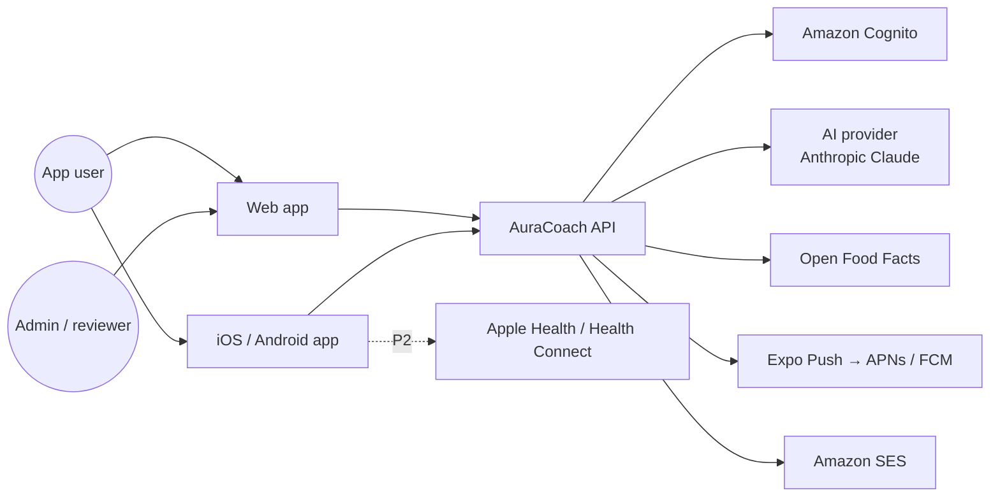

# High-Level Design

Status: Draft · Related: [diagrams](architecture-diagrams.md), [security](security-architecture.md), [deployment](deployment-architecture.md), [ADRs](ADR/)

## 1. Overview

AuraCoach is one **modular monolith** API (NestJS) with a separate **worker** process from the same codebase, serving a **Next.js** web app (users + admin) and an **Expo React Native** app (iOS + Android). PostgreSQL is the system of record, Redis backs caching, rate limits and BullMQ jobs, S3 holds media. AI calls go through an internal **AI gateway** module; deterministic **workout** and **nutrition engines** own every number and every plan change.

## 2. Technology stack

| Layer | Choice | Why | Alternatives considered |
|---|---|---|---|
| Monorepo | pnpm workspaces + Turborepo | Shared TS packages across web, mobile, API; cached builds | Nx (heavier), separate repos (duplicated contracts) |
| Web | Next.js 15 (App Router), TypeScript, TanStack Query | SSR for marketing/SEO, RSC for admin, one React skillset | Remix, Vite SPA |
| Mobile | Expo SDK (React Native, New Architecture), Expo Router, EAS Build/Update | One codebase for iOS + Android, native modules (camera, haptics, HealthKit via config plugins) | Native Swift/Kotlin (2× cost), Flutter (new language) |
| Shared | `packages/contracts` (Zod schemas → OpenAPI + TS client), `packages/domain` (pure calculation functions), `packages/ui`, `packages/ui-tokens` | One source of truth for validation and calculations | Hand-written clients |
| API | NestJS 11, REST + OpenAPI 3.1, SSE for coach streaming | Owner's existing expertise, DI, guards, interceptors | Fastify bare, tRPC (weaker for mobile/public contracts) |
| ORM / DB | Prisma 6, PostgreSQL 16 (Amazon RDS Multi-AZ) | Relational data with strong constraints; JSONB where shapes vary | MongoDB (weak relational integrity) |
| Search | PostgreSQL `pg_trgm` + `unaccent` full-text for foods and exercises | Good enough for ~100k foods, no extra infra | OpenSearch (later if needed) |
| Cache / queue | Redis 7 (ElastiCache) + BullMQ | Rate limiting, caching, scheduled and retryable jobs | SQS (fine, but BullMQ gives cron + priorities in one) |
| Storage | S3 (private buckets, KMS) + CloudFront signed URLs | Exercise media public-cached; user media private | — |
| Identity | Amazon Cognito user pool (email, Google, Apple), PKCE | Standards-based OIDC, MFA, managed password storage | Auth0/Clerk (cost), self-built (risk) |
| AI | AI gateway with provider adapters; default Anthropic Claude (`claude-opus-5-5`) | Tool use + structured outputs; swap providers by config | Direct SDK calls in features (lock-in) |
| Push / email | Expo Push (APNs/FCM), Amazon SES | Simple, cheap | OneSignal |
| Observability | OpenTelemetry → Grafana Cloud (Tempo, Loki, Prometheus), Sentry for client crashes | Tracing across API/worker/AI | Datadog (cost) |
| IaC / CI | Terraform, GitHub Actions, Docker | Matches owner's existing setup | CDK |
| Hosting | AWS `ap-south-1`, ECS Fargate (API, worker, web) | Data residency for India, no cluster ops | EKS (owner has templates; reconsider at scale) |

## 3. System context

## 4. Containers

| Container | Responsibility | Scaling |
|---|---|---|
| `web` (Next.js) | User web app, admin console, marketing pages | 2+ Fargate tasks behind ALB, CloudFront in front |
| `api` (NestJS HTTP) | REST + SSE, authz, validation, domain modules | Horizontal on CPU and p95 latency |
| `worker` (NestJS, no HTTP) | BullMQ consumers: notifications, weekly adaptation, summaries, exports, deletions, media processing | Horizontal on queue depth |
| PostgreSQL | System of record | Multi-AZ, read replica added when needed |
| Redis | Cache, rate limits, queues, SSE fan-out | Single primary + replica |
| S3 + CloudFront | Exercise media (public-read via CDN), user uploads (private, signed) | Managed |

## 5. Modules (bounded contexts inside the monolith)

| Module | Owns | Depends on |
|---|---|---|
| `identity` | Session validation, user provisioning from Cognito, roles/permissions | — |
| `users` | Profile, preferences, consents, export, deletion | identity |
| `onboarding` | Screening, assessment, initial plan orchestration | users, workouts, nutrition |
| `workouts` | Exercise library, templates, plans, sessions, sets, progression engine | users |
| `nutrition` | Foods, nutrients, units, recipes, meal plans, logs, targets engine | users |
| `progress` | Measurements, check-ins, analytics, plateau detection | workouts, nutrition |
| `coach` | Conversations, orchestrator, tools, proposals (`Recommendation`), memory | ai-gateway, all domain modules via their public services |
| `ai-gateway` | Provider adapters, prompts registry, safety filters, usage metering, budgets | — |
| `notifications` | Preferences, scheduling, delivery, devices | users |
| `integrations` (P2) | HealthKit / Health Connect ingestion | progress |
| `admin` | Content workflows, review queues, configuration, dashboards | all |
| `audit` | Append-only audit events | — |
| `billing` (P2) | Subscriptions, entitlements | users |

Rules: modules talk through exported application services (or domain events via an in-process event bus), never through each other's Prisma models. Each module has its own Prisma schema file section and table prefix-free names but enforced ownership via lint rule (`eslint-plugin-boundaries`).

## 6. Key flows

### 6.1 Request path

Client → CloudFront/ALB → `api` → global guards (JWT validation, rate limit) → controller (Zod DTO validation) → module service → policy check (resource ownership) → repository (Prisma) → response mapping. Correlation id from `traceparent` propagates to logs, jobs and AI calls.

### 6.2 Plan generation

`onboarding` collects answers → `workouts.PlanGenerator` (pure function in `packages/domain`) selects template by goal/experience/days/equipment → filters exercises by equipment and contraindications → assigns volume and intensity caps → `PlanValidator` checks rules → persisted in one transaction with `nutrition.TargetsCalculator` output.

### 6.3 Coach turn

See [ai-coach LLD](../modules/ai-coach/LLD.md). The model can only call allow-listed tools; every tool runs with the session's user id, read tools return minimal fields, write tools only create **proposals**, which the user accepts via a normal API endpoint that re-validates.

### 6.4 Weekly adaptation (worker)

Cron per user's local Sunday 04:00 → load last week's sessions, check-ins, weight trend → progression engine computes next week → validator → stored as new `WorkoutPlanWeek` + `Recommendation` for target changes → notification "Your next week is ready".

## 7. Data and trust boundaries

| Boundary | Controls |
|---|---|
| Internet → edge | TLS 1.2+, AWS WAF managed rules, CloudFront |
| Edge → API | JWT (Cognito) validation, rate limits per IP and user, request size limits |
| API → DB | IAM-auth or Secrets Manager credentials, private subnets, TLS, least-privilege roles |
| API → AI provider | Pseudonymous ids only, minimised context, no photos without consent, zero-retention option where provider supports it, outbound allow-list |
| API → S3 | Pre-signed PUT with content-type and size limits; malware scan on upload |
| Admin → API | Separate role claims, MFA required, IP allow-list optional |

## 8. Authentication and authorisation

- Cognito user pool with Google and Apple federation; mobile uses Authorization Code + PKCE via `expo-auth-session`; web uses the same via a BFF route in Next.js that keeps tokens in `HttpOnly; Secure; SameSite=Lax` cookies.
- API validates access tokens (JWKS cached), maps `sub` to `User.id`.
- RBAC roles: `user`, `content_editor`, `nutrition_reviewer`, `safety_reviewer`, `ai_admin`, `support`, `owner`. Permissions are strings (`exercise:publish`) mapped to roles in DB.
- Resource-level: every user-owned table has `userId`; repositories require `userId` in the query (`findOwned(userId, id)`), returning 404 on mismatch. A Prisma extension rejects queries on owned models without a `userId` filter.

## 9. Scalability, availability, caching

- Stateless API; sessions in JWT; SSE connections rebalanced on deploy with client reconnect.
- Caching: exercise library and food search results (Redis, 1 h, tag-based invalidation on publish); dashboard aggregates (5 min, invalidated on new log); HTTP `ETag` for library endpoints; CloudFront for media.
- Read-heavy analytics use `DailyNutritionSummary` and `WorkoutWeekSummary` materialised by jobs.
- RDS Multi-AZ (RPO ≈ 0 for AZ failure), automated backups 14 days + PITR, weekly snapshot copied to `ap-southeast-1` for regional DR (RPO 24 h, RTO 4 h).
- Graceful degradation: AI outage → coach disabled banner; push outage → in-app inbox still updates.

## 10. Privacy

- Data minimisation: no names required (display name only), DOB stored as date, location never collected.
- Health data classified **Sensitive**: screening answers, conditions, injuries, measurements, photos. Encrypted at rest (RDS KMS); screening free-text additionally field-encrypted.
- Consents versioned in `Consent`; AI coach requires its own consent; withdrawal stops AI processing immediately.
- Export and deletion via jobs; deletion grace 30 days; backups age out within 35 days.
- Logs never contain request bodies for health endpoints; PII scrubbing in log formatter and Sentry `beforeSend`.

## 11. Observability

- OpenTelemetry auto-instrumentation (HTTP, Prisma, Redis, BullMQ) + manual spans for engines and AI calls.
- Metrics: RED per route, queue depth/latency, AI tokens/cost/latency/errors by model and feature, safety-flag rate.
- SLOs: API availability 99.5%, p95 < 400 ms non-AI, coach first-token p95 < 3 s, notification delivery within 5 min of schedule 99%.
- Alerts to Slack/PagerDuty: SLO burn, error spikes, AI budget 80%/100%, job failures.

## 12. Cost management

- Fargate right-sizing (API 0.5 vCPU/1 GB × 2 at beta), RDS `db.t4g.medium` Multi-AZ, ElastiCache `cache.t4g.small`.
- AI: per-user daily message quota (default 30), per-feature effort settings, prompt caching of static system prompt and tool definitions, conversation summarisation beyond 20 turns, hard monthly budget with kill switch to fallback FAQ mode.
- Estimated beta infra ≈ USD 450–600/month excluding AI.

## 13. ADR index

| ADR | Title |
|---|---|
| [001](ADR/ADR-001-modular-monolith.md) | Modular monolith in a monorepo |
| [002](ADR/ADR-002-client-stack.md) | Next.js web and Expo mobile |
| [003](ADR/ADR-003-backend-data-stack.md) | NestJS, Prisma, PostgreSQL, Redis/BullMQ |
| [004](ADR/ADR-004-deterministic-engines-ai-proposes.md) | Deterministic engines; AI explains and proposes |
| [005](ADR/ADR-005-ai-provider-gateway.md) | Provider-independent AI gateway |
| [006](ADR/ADR-006-authentication.md) | Cognito for identity |
| [007](ADR/ADR-007-hosting.md) | AWS ap-south-1 on ECS Fargate |
| [008](ADR/ADR-008-nutrition-data.md) | Curated nutrition data with provenance |
