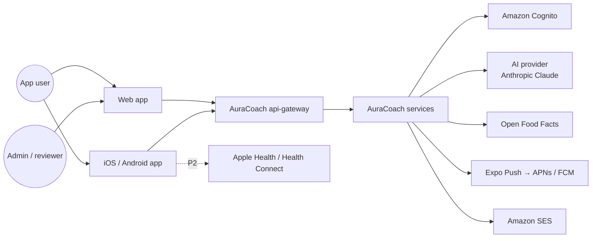

# High-Level Design

Status: Draft · Related: [service catalog](service-catalog.md), [diagrams](architecture-diagrams.md), [security](security-architecture.md), [deployment](deployment-architecture.md), [ADRs](ADR/)

## 1. Overview

AuraCoach is a set of **NestJS microservices in one monorepo** (same layout as the-aura-lab), behind an nginx **api-gateway**, serving a **Next.js** web app (users + admin) and an **Expo React Native** app (iOS + Android). Each service owns its PostgreSQL database; services talk through a few internal REST calls and outbox events on Redis Streams; Redis also backs caching, rate limits and BullMQ jobs; S3 holds media. AI calls go only through the **AI gateway** inside coach-service; deterministic **workout** and **nutrition engines** own every number and every plan change.

## 2. Technology stack

| Layer | Choice | Why | Alternatives considered |
|---|---|---|---|
| Monorepo | pnpm workspaces + Turborepo | Shared TS packages across web, mobile, API; cached builds | Nx (heavier), separate repos (duplicated contracts) |
| Web | Next.js 15 (App Router), TypeScript, TanStack Query | SSR for marketing/SEO, RSC for admin, one React skillset | Remix, Vite SPA |
| Mobile | Expo SDK (React Native, New Architecture), Expo Router, EAS Build/Update | One codebase for iOS + Android, native modules (camera, haptics, HealthKit via config plugins) | Native Swift/Kotlin (2× cost), Flutter (new language) |
| Shared | `packages/contracts` (Zod schemas → OpenAPI + TS client + event schemas), `packages/domain` (pure calculation functions), `packages/service-kit` (NestJS guards, outbox, event bus, logging), `packages/ui`, `packages/ui-tokens` | One source of truth for validation and calculations | Hand-written clients |
| Services | 8 deployables: api-gateway (nginx), profile, workout, nutrition, progress, coach, notification, audit ([catalog](service-catalog.md)) | Owner's chosen operating model, independent deploy and scale | Modular monolith (earlier draft, ADR-001) |
| API | NestJS 11 per service, REST + OpenAPI 3.1 at the gateway, SSE for coach streaming | Owner's existing expertise, DI, guards, interceptors | Fastify bare, tRPC (weaker for mobile/public contracts) |
| Service communication | Internal REST (`/internal/v1`, service JWTs) + transactional outbox → Redis Streams | Few sync calls, reliable async facts | Kafka/MSK, SNS+SQS (ADR-009) |
| ORM / DB | Prisma 6 per service, PostgreSQL 16 (Amazon RDS Multi-AZ, one database per service) | Relational data with strong constraints; JSONB where shapes vary | MongoDB (weak relational integrity) |
| Search | PostgreSQL `pg_trgm` + `unaccent` full-text for foods and exercises | Good enough for ~100k foods, no extra infra | OpenSearch (later if needed) |
| Cache / queue | Redis 7 (ElastiCache) + BullMQ | Rate limiting, caching, scheduled and retryable jobs | SQS (fine, but BullMQ gives cron + priorities in one) |
| Storage | S3 (private buckets, KMS) + CloudFront signed URLs | Exercise media public-cached; user media private | — |
| Identity | Amazon Cognito user pool (email, Google, Apple), PKCE | Standards-based OIDC, MFA, managed password storage | Auth0/Clerk (cost), self-built (risk) |
| AI | AI gateway with provider adapters; default Anthropic Claude (`claude-opus-5-5`) | Tool use + structured outputs; swap providers by config | Direct SDK calls in features (lock-in) |
| Push / email | Expo Push (APNs/FCM), Amazon SES | Simple, cheap | OneSignal |
| Observability | OpenTelemetry → Grafana Cloud (Tempo, Loki, Prometheus), Sentry for client crashes | Tracing across API/worker/AI | Datadog (cost) |
| IaC / CI | Terraform, GitHub Actions, Docker | Matches owner's existing setup | CDK |
| Hosting | AWS `ap-south-1`, staged: k3s on one EC2 Graviton node per account for beta, EKS for growth; one generic Helm chart via Terraform `helm_release` in both | Data residency for India; beta infra within the PRD cost target; same chart and pipeline pattern as the-aura-lab | EKS from day one, ECS Fargate, Docker Compose VM, Lambda (ADR-007) |

## 3. System context

## 4. Containers

| Container | Responsibility | Scaling |
|---|---|---|
| `web` (Next.js) | User web app, admin console, auth BFF, marketing pages | HPA on CPU, CloudFront in front |
| `api-gateway` (nginx) | Single public entry for `/v1/*`: path routing, request ids, coarse rate limits, body limits, SSE pass-through | HPA on connections |
| 7 NestJS services | See [service catalog](service-catalog.md). Each runs an `http` deployment and, where it has jobs or consumers, a `worker` deployment from the same image | HPA per service (CPU, p95 latency, queue depth / stream lag) |
| PostgreSQL | One RDS instance, one database + user per service | Multi-AZ; a busy service moves to its own instance |
| Redis | Cache, rate limits, BullMQ, Redis Streams event bus | Primary + replica, AOF on |
| S3 + CloudFront | Exercise media (public via CDN), user files (private, signed) | Managed |

## 5. Services

| Service | Owns | Sync dependencies |
|---|---|---|
| `profile-service` | Users, profile, preferences, consents, screening, conditions, goals, assessment, roles, privacy requests; orchestrates onboarding | workout, nutrition (onboarding only) |
| `workout-service` | Exercise library, templates, plans, sessions, sets, PRs, progression engine | — |
| `nutrition-service` | Foods, units, recipes, targets engine, meal plans, logs, summaries | — |
| `progress-service` | Measurements, check-ins, dashboard and analytics read models, plateau detection, integrations (P2) | workout (today's session) |
| `coach-service` | Conversations, orchestrator, tools, proposals (`Recommendation`), memory, AI gateway, prompts, model config, usage | profile, workout, nutrition, progress (reads, proposals) |
| `notification-service` | Devices, preferences, scheduling, delivery | — |
| `audit-service` | Append-only audit store and search | — |
| `billing-service` (P2) | Subscriptions, entitlements | — |

Rules ([ADR-001](ADR/ADR-001-microservices-monorepo.md), [ADR-009](ADR/ADR-009-service-communication.md)): no shared tables or cross-database queries; only the sync calls listed in the [catalog](service-catalog.md#4-allowed-synchronous-dependencies); everything else by outbox events; data needed from another service is kept as an event-fed replica.

## 6. Key flows

### 6.1 Request path

Client → CloudFront → ALB → `api-gateway` (route by prefix, `X-Request-Id`) → service → `service-kit` guards (JWT validation against Cognito JWKS, rate limit, permissions, consent) → controller (Zod DTO validation) → application service → ownership check → Prisma repository → response. `traceparent` propagates through gateway, services, events and AI calls.

### 6.2 Onboarding and plan generation

profile-service stores the answers, then calls workout-service (`POST /internal/v1/plans`) and nutrition-service (`POST /internal/v1/targets`) in parallel with the onboarding id as idempotency key; each runs its engine from `packages/domain` and validates the output. If either call fails, onboarding returns `202 PLANNING` and both services complete from the `OnboardingCompleted` event; the app polls status. Detail: [service catalog §6.1](service-catalog.md#61-onboarding-saga-orchestrated-by-profile-service).

### 6.3 Coach turn

See [ai-coach LLD](../modules/ai-coach/LLD.md). The model can only call allow-listed tools; coach-service executes them by calling the owning service's internal API with a service token bound to the conversation owner. Write tools only create **proposals**; the owning service validates them and applies them only after the user accepts.

### 6.4 Weekly adaptation

workout-service worker, Sunday 04:00 user-local: reads last week's sessions and its event-fed replica of check-ins and weight trend → progression engine → validator → new `WorkoutPlanWeek` → `PlanWeekReady` event → notification-service sends "Your next week is ready", progress-service updates read models. nutrition-service runs target adaptation the same way and asks coach-service to create a `Recommendation` via `TargetChangeProposed`.

### 6.5 Dashboard

progress-service keeps per-user daily facts built from `WorkoutCompleted`, `SessionMissed`, `MealLogged`, `TargetsSet` and its own measurements, so `GET /v1/dashboard/today` needs one sync call only (today's session from workout-service, 300 ms timeout; on timeout the card shows "Open Train"). Data is eventually consistent, typically under a second behind.

## 7. Data and trust boundaries

| Boundary | Controls |
|---|---|
| Internet → edge | TLS 1.2+, AWS WAF managed rules, CloudFront |
| Edge → gateway → services | Every service validates the Cognito JWT itself (no trust in the gateway alone), rate limits per IP and user, request size limits |
| Service → service | Short-lived service JWTs (`aud` = target) via `InternalServiceGuard`; Kubernetes NetworkPolicies allow only the documented callers; user identity carried as a signed claim |
| Service → its DB | Own database user per service (Secrets Manager, rotated), private subnets, TLS |
| Service → event bus | Redis ACL user per service: publish to own streams, read only subscribed streams |
| coach-service → AI provider | Pseudonymous ids only, minimised context, no photos without consent, outbound allow-list (only coach-service may egress to the provider) |
| Service → S3 | Per-service S3 prefix in the role policy (IRSA role per service on EKS; node role plus NetworkPolicy on k3s, see ADR-007); pre-signed PUT with type and size limits; malware scan on upload |
| Admin → services | Role claims, MFA required, IP allow-list optional |

## 8. Authentication and authorisation

- Cognito user pool with Google and Apple federation; mobile uses Authorization Code + PKCE via `expo-auth-session`; web uses the same via a Next.js BFF that keeps tokens in `HttpOnly; Secure; SameSite=Lax` cookies.
- Each service validates access tokens with `service-kit` (`jose`, JWKS cached) and uses `sub` as the user id: `User.id` equals the Cognito `sub`, created by profile-service on the first call, which also publishes `UserRegistered` ([auth LLD §3](../modules/authentication/LLD.md#3-user-identity-across-services)).
- RBAC roles: `user`, `content_editor`, `nutrition_reviewer`, `safety_reviewer`, `ai_admin`, `support`, `owner`. profile-service owns role grants (audited) and mirrors them to Cognito groups; services read the `cognito:groups` claim and map groups to permission strings (`exercise:publish`) with the shared map in `packages/contracts`.
- Resource-level: every user-owned table has `userId`; repositories require it (`findOwned(userId, id)`) and return 404 on mismatch. A Prisma extension in `service-kit` rejects queries on owned models without a `userId` filter.

## 9. Scalability, availability, caching

- Stateless services; sessions in JWT; SSE connections (coach-service) drain on deploy and clients reconnect with `Last-Event-ID`.
- Each service scales on its own signal: coach on concurrent streams, nutrition on search latency, workers on queue depth and stream lag.
- Caching inside the owning service: exercise library and food search (Redis, 1 h, invalidated on `ContentPublished`); dashboard (5 min, invalidated by the events that feed it); HTTP `ETag` on library endpoints; CloudFront for media.
- Failure isolation: circuit breakers on every sync call; a down service degrades only its own features (coach down → banner; progress down → Today shows workout and nutrition cards from their own services via the app's fallback calls).
- Events retained 7 days, so a consumer that was down catches up; dead-letter streams alert on poison messages.
- RDS Multi-AZ, automated backups 14 days + PITR, weekly snapshot copied to `ap-southeast-1` (RPO 24 h, RTO 4 h for regional loss).

## 10. Privacy

- Data minimisation: display name only, DOB stored as date, location never collected.
- Health data classified **Sensitive**: screening answers, conditions, injuries, measurements, photos. Encrypted at rest (RDS KMS); screening free-text additionally field-encrypted. Replicas in other services hold only the fields they need (codes, not notes).
- Consents versioned in profile-service; `ConsentChanged` events stop coach and notification processing immediately on withdrawal.
- Export and deletion fan out by events and are tracked to completion per service ([catalog §6.3](service-catalog.md#63-account-deletion-and-export)); deletion grace 30 days; backups age out within 35 days.
- Logs never contain request bodies for health endpoints; event payloads carry ids and codes, not free text.

## 11. Observability

- OpenTelemetry in every service (HTTP, Prisma, Redis, BullMQ, Redis Streams producer/consumer spans linked by `traceparent` in the event envelope) + manual spans for engines and AI calls → Grafana (Tempo, Loki, Prometheus).
- Metrics: RED per route and service, outbox backlog, stream consumer lag, dead-letter count, circuit-breaker state, AI tokens/cost/latency/errors, safety-flag rate.
- SLOs: API availability 99.5%, p95 < 400 ms non-AI, coach first-token p95 < 3 s, event end-to-end lag p95 < 2 s, notification delivery within 5 min of schedule 99%.
- Alerts: SLO burn, error spikes, consumer lag > 60 s, any dead-letter message, AI budget 80%/100%, job failures.

## 12. Cost management

- Hosting is staged ([ADR-007](ADR/ADR-007-hosting.md)). Stage 1 (beta): prod on one k3s node (`t4g.xlarge`), RDS `db.t4g.small` single-AZ with PITR and a database per service, ElastiCache `cache.t4g.micro`, CloudFront + WAF straight to the node (no ALB, no NAT), DNS Firewall for egress; dev and staging share one `t4g.large` k3s node stopped out of hours. Stage 2 (growth): EKS with Karpenter, RDS Multi-AZ, ElastiCache with a replica, when a move trigger in the ADR is met.
- AI: per-user daily message quota (default 30), per-feature effort settings, prompt caching of static system prompt and tool definitions, conversation summarisation beyond 20 turns, hard monthly budget with kill switch to fallback FAQ mode.
- AI routing for beta: Sonnet 5.5 for coach chat, Haiku 5.5 for the safety classifier, Batch API for summaries, pending evals ([AI coach LLD §2](../modules/ai-coach/LLD.md)).
- Estimated beta cost ≈ USD 275/month infrastructure (all environments and shared tools) + ≈ USD 335/month AI; Stage 2 infrastructure ≈ USD 1,250/month.

## 13. ADR index

| ADR | Title |
|---|---|
| [001](ADR/ADR-001-microservices-monorepo.md) | Microservices in one monorepo |
| [002](ADR/ADR-002-client-stack.md) | Next.js web and Expo mobile |
| [003](ADR/ADR-003-backend-data-stack.md) | NestJS, Prisma, PostgreSQL, Redis/BullMQ |
| [004](ADR/ADR-004-deterministic-engines-ai-proposes.md) | Deterministic engines; AI explains and proposes |
| [005](ADR/ADR-005-ai-provider-gateway.md) | Provider-independent AI gateway |
| [006](ADR/ADR-006-authentication.md) | Cognito for identity |
| [007](ADR/ADR-007-hosting.md) | Staged hosting on AWS ap-south-1: k3s on EC2 for beta, EKS for growth |
| [008](ADR/ADR-008-nutrition-data.md) | Curated nutrition data with provenance |
| [009](ADR/ADR-009-service-communication.md) | Internal REST plus outbox events on Redis Streams |
