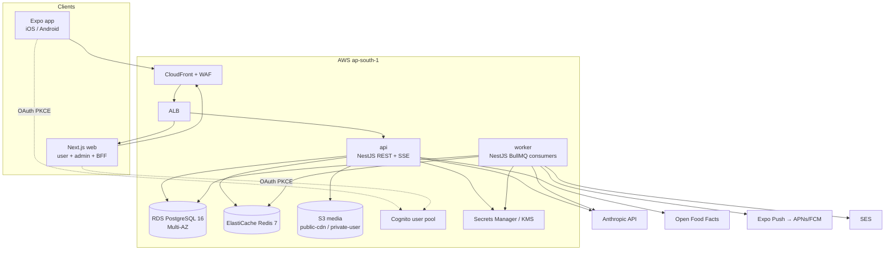
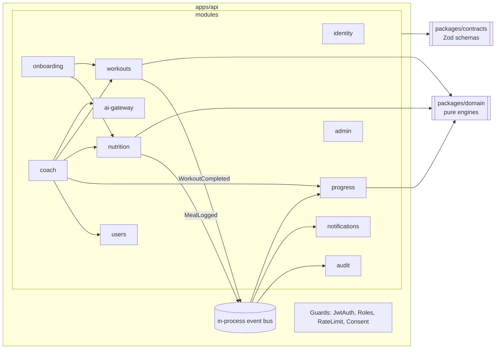
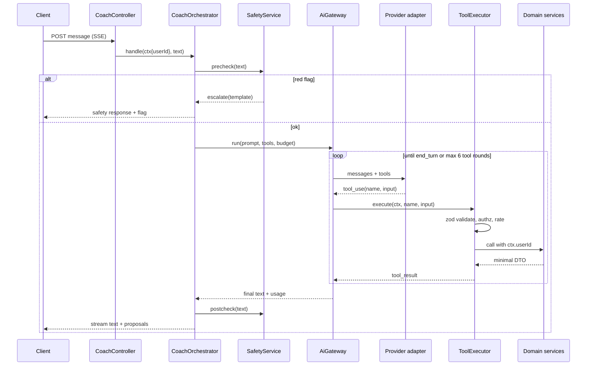

# Architecture Diagrams

C4-style views in Mermaid. Narrative lives in the [HLD](HLD.md).

## 1. Containers

## 2. API components

## 3. Coach tool-call sequence

## 4. Deployment

See [deployment-architecture.md](deployment-architecture.md).
