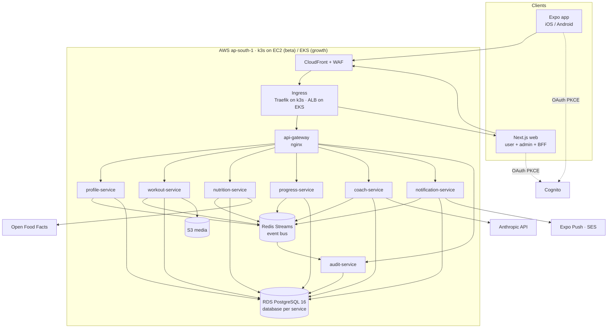
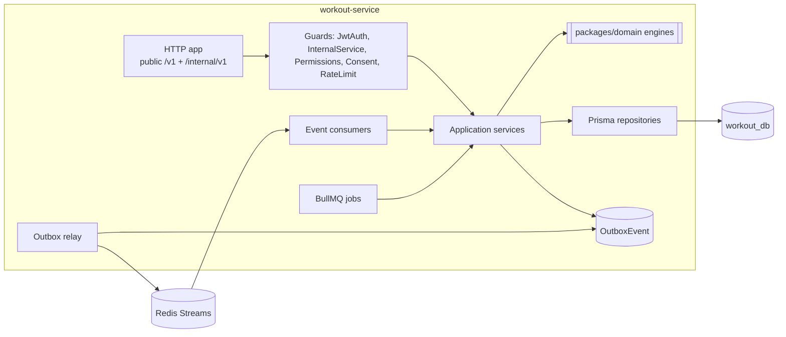
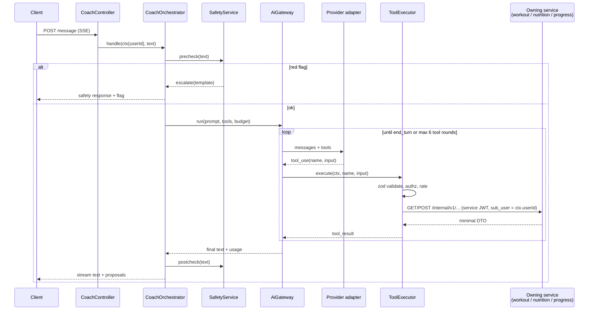

# Architecture Diagrams

C4-style views in Mermaid. Narrative lives in the [HLD](HLD.md).

## 1. Containers

## 2. Inside one service

Every NestJS service has the same shape, built from `packages/service-kit`:

The `http` process and the `worker` process (relay, consumers, jobs) run from the same image as separate Helm deployments.

## 3. Coach tool-call sequence

## 4. Deployment

See [deployment-architecture.md](deployment-architecture.md).
