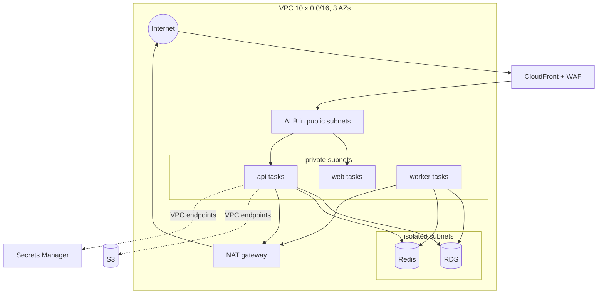
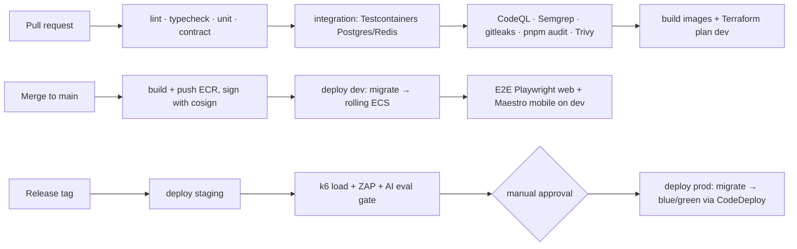

# Deployment Architecture

## 1. Environments

| Env | AWS account | Purpose | Data | Scale |
|---|---|---|---|---|
| local | — | Docker Compose: Postgres 16, Redis 7, MinIO, Mailpit, cognito-local stub | Seed + synthetic | — |
| dev | `auracoach-dev` | Integration of `main`, preview of features | Synthetic | 1 task each, single-AZ RDS |
| staging | `auracoach-staging` | Release candidates, E2E, load, DAST | Synthetic, prod-like volume | Mirrors prod at 50% |
| prod | `auracoach-prod` | Users | Real | API 2–10 tasks, worker 1–6, RDS Multi-AZ |

Mobile: EAS channels `development`, `preview` (staging API), `production`. OTA updates (EAS Update) only for JS changes compatible with the installed runtime version.

## 2. Network

Egress to AI provider, Open Food Facts, Expo Push and SES via NAT with an egress allow-list (AWS Network Firewall in prod; security-group + DNS firewall in lower envs).

## 3. CI/CD (GitHub Actions)

- Turborepo affected-graph runs only what changed.
- Migrations run as a one-off ECS task before the new task set; only **expand** migrations deploy with code; **contract** migrations ship one release later.
- Rollback: CodeDeploy blue/green reverts traffic in < 5 min; DB rollbacks avoided by expand/contract; feature flags (Unleash self-hosted or DB-backed flags) for risky features.
- Mobile: EAS Build on tag → TestFlight / Play internal track → staged rollout 10% → 50% → 100%.

## 4. Infrastructure as code

`infra/terraform/` with modules `network`, `ecs-service`, `rds`, `redis`, `s3-cdn`, `cognito`, `observability`, `budgets`, and `envs/{dev,staging,prod}`. State in S3 with DynamoDB locking, one state per env. Reuse patterns from `eks-terraform-template` where applicable (VPC module, tagging).

## 5. Backup and disaster recovery

| Asset | Backup | RPO | RTO |
|---|---|---|---|
| RDS | Automated daily + PITR 14 days; weekly cross-region copy to `ap-southeast-1` | 5 min (PITR) / 24 h (region) | 1 h / 4 h |
| S3 user media | Versioning + cross-region replication | 15 min | 4 h |
| Redis | Not backed up (cache + queues reconstructable; jobs idempotent) | — | 15 min |
| Config | Terraform + Git | 0 | 1 h |

DR drill each quarter: restore staging from prod-snapshot-equivalent synthetic dataset and measure.

## 6. Operations docs (created in Phase 4)

`docs/operations/local-development.md`, `deployment.md`, `monitoring.md`, `troubleshooting.md`, `incident-response.md` are written alongside the foundation code so they describe real commands.
