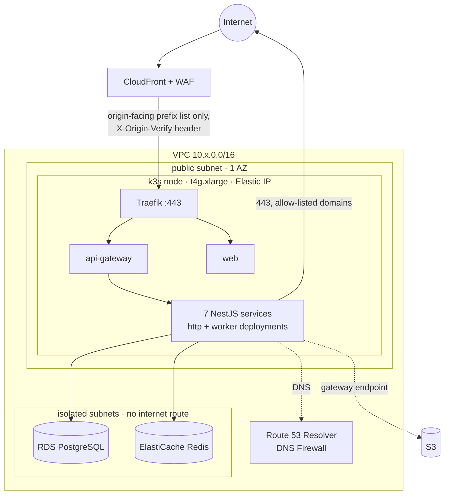
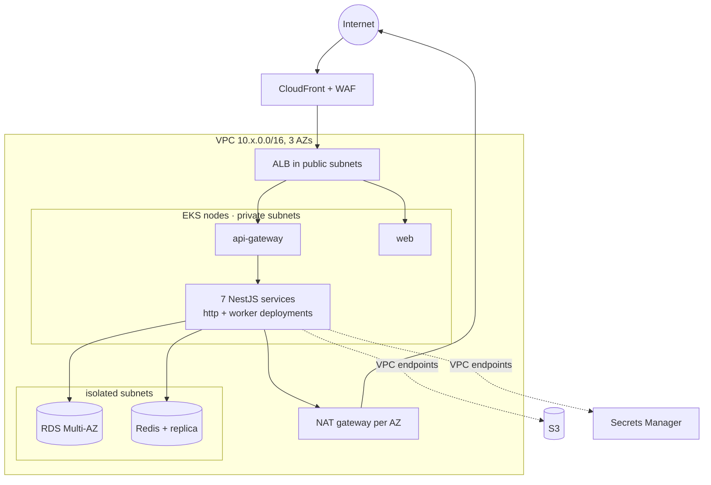
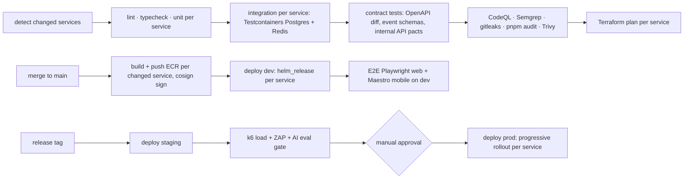

# Deployment Architecture

Platform decision: [ADR-007](ADR/ADR-007-hosting.md). Services: [service catalog](service-catalog.md).

Hosting is staged ([ADR-007](ADR/ADR-007-hosting.md)): **Stage 1** (beta) runs k3s on one EC2 Graviton node per account; **Stage 2** (growth) moves to EKS when a trigger in the ADR is met. Sections 1–3 and 5 describe Stage 1 and keep the Stage 2 layout alongside it. The Helm chart, Terraform service module and CI/CD rules apply to both stages unchanged.

## 1. Environments

### Stage 1 (beta)

| Env | AWS account | Purpose | Data | Scale |
|---|---|---|---|---|
| local | — | Docker Compose: Postgres 16 (one database per service), Redis 7, MinIO, Mailpit, cognito-local stub, nginx gateway; `pnpm dev --filter <service>` runs any subset | Seed + synthetic | — |
| dev | `auracoach-nonprod` | Integration of `main` | Synthetic | Namespaces on the shared non-prod k3s node (`t4g.large`), 1 replica per service, Postgres and Redis as StatefulSets |
| staging | `auracoach-nonprod` | Release candidates, E2E, load, DAST | Synthetic, prod-like volume | Namespaces on the same node, 1 replica per service; node stopped out of hours (weekdays 08:00–20:00 IST); load tests stub the AI provider |
| prod | `auracoach-prod` | Users | Real | One k3s node (`t4g.xlarge`, EC2 auto-recovery), 2 replicas of `api-gateway`, `web` and each service's `-http` deployment, 1 of each worker; RDS `db.t4g.small` single-AZ with PITR; ElastiCache `cache.t4g.micro` |

### Stage 2 (growth)

| Env | AWS account | Scale |
|---|---|---|
| dev, staging | `auracoach-nonprod`, or `auracoach-dev` and `auracoach-staging` once staging must mirror prod | k3s node as in Stage 1, or EKS with 1 node group (2 × `t4g.large`); staging at 50% of prod, scaled down out of hours |
| prod | `auracoach-prod` | EKS 3 AZs, Karpenter, 2–10 replicas per service, RDS Multi-AZ, ElastiCache with a replica |

Mobile: EAS channels `development`, `preview` (staging API), `production`. OTA updates (EAS Update) only for JS changes compatible with the installed runtime version.

## 2. Kubernetes layout

Both stages use the same chart and namespaces. Rows marked Stage 1 / Stage 2 differ.

| Item | Convention |
|---|---|
| Namespaces | `aura-edge` (api-gateway, web), `aura-services` (all NestJS services), `aura-data` (non-prod Postgres and Redis), `aura-system` (controllers). On the non-prod node the environment namespaces are prefixed: `dev-aura-edge`, `staging-aura-services`, …; `aura-system` is shared by the cluster and not prefixed |
| Chart | One generic chart `infra/helm/aura-service`, values in `infra/helm/values` (shared `common.yaml`, one file per environment, one per deployable, `stage/eks.yaml` for Stage 2); Terraform passes only deploy inputs (image tag, registry, Cognito ids, data store CIDRs, origin header). See [deployment](../operations/deployment.md) |
| Deployments per service | `<name>-http` (Service + HPA + PDB) and, when the service has jobs or consumers, `<name>-worker`. Stage 1: HPA in the chart but off (one node leaves little room; max 3 when turned on), fixed replica counts, PDB `minAvailable: 1` when there are two or more replicas, workers at a fixed count (no KEDA). Stage 2: workers scale on queue depth / stream lag via KEDA |
| Migrations | Helm pre-upgrade hook Job running `prisma migrate deploy` for that service only |
| Config and secrets | ConfigMap rendered by the chart; secrets via External Secrets Operator from AWS Secrets Manager. Stage 1: each environment's SecretStore assumes a role (from the node instance role) that may read only `auracoach/<env>/*`, so dev and staging on the shared node cannot read each other's secrets. Stage 2: IRSA role per service |
| AWS API access from pods | Stage 1: only pods that need AWS (External Secrets, workout-service for S3, notification-service for SES, profile-service for Cognito admin calls) may reach the instance metadata endpoint, by NetworkPolicy; IMDSv2 required, hop limit 2. Stage 2: IRSA |
| Network | Default-deny NetworkPolicies (enforced by the k3s network policy controller in Stage 1, VPC CNI network policies in Stage 2); allow rules generated from the catalog's sync-dependency graph; internet egress only for pods that need it, on 443 (coach-service for the AI provider, nutrition-service for Open Food Facts, notification-service for Expo Push) |
| Probes | `/health/live` and `/health/ready` (DB, Redis, and for consumers stream connectivity) from `service-kit` |
| Ingress | Stage 1: CloudFront → k3s Traefik on the node → `api-gateway` and `web`. Stage 2: AWS Load Balancer Controller → ALB → `api-gateway` and `web`. Nothing else is internet-facing |
| Cluster add-ons (Helm releases) | Stage 1: Traefik config (bundled with k3s), cert-manager, External Secrets Operator, system-upgrade-controller. Stage 2: AWS Load Balancer Controller, Karpenter, External Secrets Operator, KEDA |
| Cluster access | Stage 1: k3s API (6443) not exposed; operators and CI reach it through an SSM Session Manager port forward; no SSH. Stage 2: private EKS endpoint, access entries mapped from IAM roles |

## 3. Network

### Stage 1

- **Inbound.** The node's security group allows 443 only from the CloudFront origin-facing managed prefix list. Traefik serves a cert-manager certificate for `origin.<domain>` and drops requests that lack the `X-Origin-Verify` header value (stored in Secrets Manager, rotated with the CloudFront config). No port 22 or 6443 is open.
- **Outbound.** The node has a public IP, so there is no NAT gateway. Its security group allows 443 to the internet, 5432 and 6379 to the data-store security groups, and DNS/NTP to the VPC resolver. Route 53 Resolver DNS Firewall allows only listed domains (AWS service endpoints, ECR, the AI provider, Open Food Facts, Expo Push, Let's Encrypt, Grafana Cloud, Sentry, GitHub) and blocks the rest. DNS Firewall does not stop connections to raw IP addresses, so the NetworkPolicy egress rules in §2 are the second layer.
- **S3** through a gateway VPC endpoint (free). Secrets Manager over its public endpoint with TLS; interface endpoints are a Stage 2 item.
- The non-prod VPC has the same shape without WAF, with in-cluster Postgres and Redis instead of the isolated subnets.

### Stage 2

Egress keeps the DNS Firewall allow-list; AWS Network Firewall is added only if the Stage 2 review needs packet-level inspection.

## 4. CI/CD (GitHub Actions)

Mirrors the-aura-lab: a service is any `services/<name>/` folder with a `Dockerfile`, and each must have `infra/helm/values/<name>.yaml`.

The pipeline is the same in both hosting stages. Only the deploy step's cluster connection differs: in Stage 1 the job assumes the environment's deploy role through GitHub OIDC, opens an SSM Session Manager port forward to the k3s API on 6443, and runs Terraform `helm_release` through it; in Stage 2 it reaches the private EKS endpoint with the same SSM port-forward pattern through a small bastion instance. Images live in ECR in both stages.

Change detection:

| Changed path | Services selected |
|---|---|
| `services/<name>/**` | `<name>` |
| `packages/contracts/**`, `packages/service-kit/**`, `packages/domain/**` | every service that depends on it (Turborepo graph) |
| `infra/helm/values/<name>.yaml` | `<name>` |
| `infra/helm/**`, `infra/terraform/service/*.tf`, `.github/workflows/**` | all |
| `apps/web/**` | web |
| `apps/mobile/**` | EAS build only |
| `docs/**` | none (docs lint only) |

Rules:
- One matrix job per service, `fail-fast: false`.
- Only **expand** migrations ship with code; **contract** migrations ship one release later.
- Event and internal API changes must be backward compatible: consumers deploy first for new event versions, producers dual-publish during migration.
- Prod rollout: canary 10% → 50% → 100% per service with automatic rollback on error-rate or latency SLO breach (Argo Rollouts via the chart, or Helm atomic upgrade + health gate in MVP).
- Mobile: EAS Build on tag → TestFlight / Play internal track → staged rollout 10% → 50% → 100%.

## 5. Infrastructure as code

`infra/terraform/` with two stacks, state in S3 with DynamoDB locking, one state per account/environment and stack. Start from `eks-terraform-template` and the-aura-lab `infra/terraform/service` module.

| Stack | Stage 1 | Stage 2 |
|---|---|---|
| `platform` | VPC (public + isolated subnets, S3 gateway endpoint), k3s EC2 node (launch template with cloud-init installing a pinned k3s version, Elastic IP, instance role, auto-recovery and status-check alarms, Instance Scheduler tag in non-prod), RDS, ElastiCache (prod), S3, CloudFront + WAF, Route 53 + DNS Firewall, Cognito, ECR, observability, budgets | VPC across 3 AZs with NAT, EKS + Karpenter, RDS Multi-AZ, ElastiCache with replica, VPC interface endpoints; the rest unchanged |
| `service` | One `helm_release` per service from its `infra/helm/values` files plus deploy inputs, database and DB user creation, Secrets Manager entries; Helm provider points at the k3s API through the SSM port forward | Same module; Helm provider points at EKS; adds the IRSA role per service |

The stage is a variable of the `platform` stack (`hosting_stage = "k3s" | "eks"`), so both live in one codebase and the `service` stack does not change between them. Nothing is applied until the owner provides AWS accounts (TAC-44).

## 6. Backup and disaster recovery

| Asset | Backup | RPO | RTO |
|---|---|---|---|
| RDS (all service databases) | Automated daily + PITR 14 days; weekly cross-region copy to `ap-southeast-1` | 5 min (PITR) / 24 h (region) | 1 h / 4 h |
| S3 user files | Versioning + cross-region replication | 15 min | 4 h |
| Redis (cache, jobs, streams) | Stage 1: ElastiCache daily snapshot. Stage 2: AOF + replica. Streams retained 7 days; outbox rows kept 7 days so events can be re-published | ≈ 0 for events (outbox) | 15 min |
| k3s cluster state (Stage 1) | Embedded etcd snapshot every 6 h to S3, 14 days kept | 6 h (state is also reproducible from Terraform + Git) | 1 h (rebuild node from Terraform, restore snapshot) |
| k3s node (Stage 1) | EC2 auto-recovery on host failure; otherwise rebuilt from the launch template | 0 (no data on the node in prod) | 5 min / 1 h |
| Config | Terraform + Git | 0 | 1 h |

Quarterly DR drill on staging: restore a database, rebuild the k3s node from Terraform and restore its etcd snapshot, replay the outbox, and confirm every consumer catches up.

Maintenance (Stage 1): OS patches through SSM Patch Manager in a weekly window (Sunday 03:00 IST, one reboot, a few minutes of downtime); k3s upgrades through system-upgrade-controller, one minor version at a time, non-prod first.

## 7. Operations docs (created in Phase 4)

`docs/operations/local-development.md`, `deployment.md`, `monitoring.md`, `troubleshooting.md` and `incident-response.md` are written alongside the foundation code so they describe real commands.
