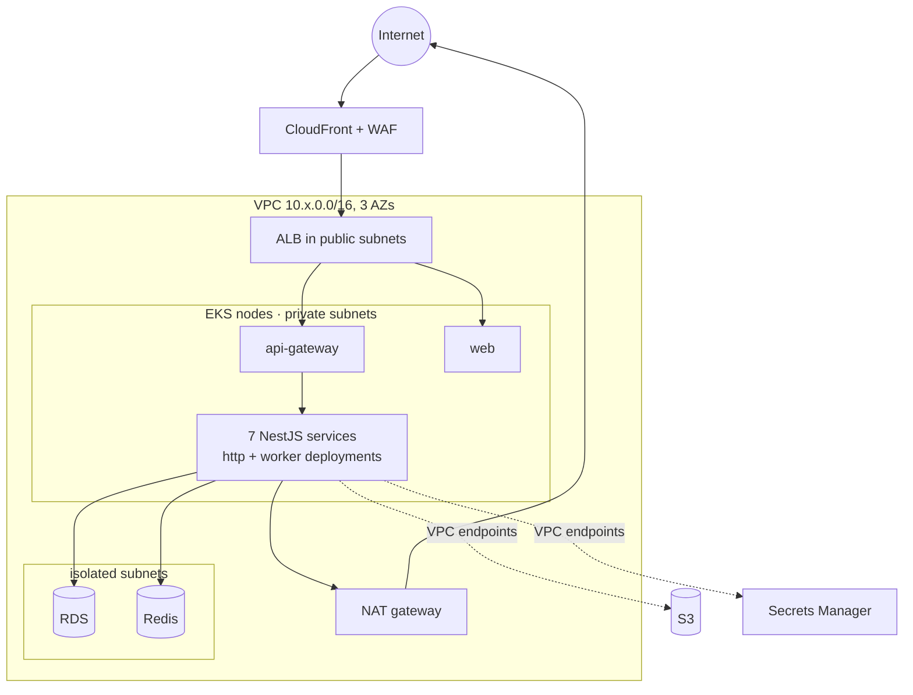
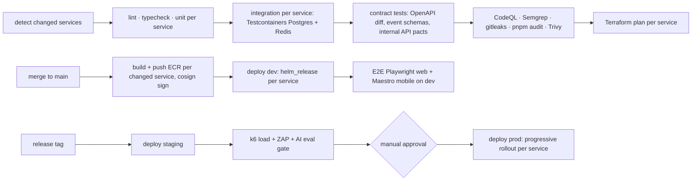

# Deployment Architecture

Platform decision: [ADR-007](ADR/ADR-007-hosting.md). Services: [service catalog](service-catalog.md).

## 1. Environments

| Env | AWS account | Purpose | Data | Scale |
|---|---|---|---|---|
| local | — | Docker Compose: Postgres 16 (one database per service), Redis 7, MinIO, Mailpit, cognito-local stub, nginx gateway; `pnpm dev --filter <service>` runs any subset | Seed + synthetic | — |
| dev | `auracoach-dev` | Integration of `main` | Synthetic | EKS, 1 node group (2 × `t4g.large`), 1 replica per service, single-AZ RDS |
| staging | `auracoach-staging` | Release candidates, E2E, load, DAST | Synthetic, prod-like volume | Mirrors prod at 50%, scaled down out of hours |
| prod | `auracoach-prod` | Users | Real | EKS 3 AZs, Karpenter, 2–10 replicas per service, RDS Multi-AZ |

Mobile: EAS channels `development`, `preview` (staging API), `production`. OTA updates (EAS Update) only for JS changes compatible with the installed runtime version.

## 2. Kubernetes layout

| Item | Convention |
|---|---|
| Namespaces | `aura-edge` (api-gateway, web), `aura-services` (all NestJS services), `aura-system` (controllers) |
| Chart | One generic chart `infra/helm/aura-service`, values per service from `infra/terraform/service/services/<name>.tfvars.json` |
| Deployments per service | `<name>-http` (Service + HPA + PDB) and, when the service has jobs or consumers, `<name>-worker` (HPA on queue depth / stream lag via KEDA) |
| Migrations | Helm pre-upgrade hook Job running `prisma migrate deploy` for that service only |
| Config and secrets | ConfigMap from tfvars; secrets via External Secrets Operator from AWS Secrets Manager; IRSA role per service |
| Network | Default-deny NetworkPolicies; allow rules generated from the catalog's sync-dependency graph; egress to AI provider only from coach-service |
| Probes | `/health/live` and `/health/ready` (DB, Redis, and for consumers stream connectivity) from `service-kit` |
| Ingress | AWS Load Balancer Controller → ALB → `api-gateway` and `web`; nothing else is internet-facing |

## 3. Network

Egress to the AI provider, Open Food Facts, Expo Push and SES goes through NAT with an allow-list (AWS Network Firewall in prod; DNS firewall in lower environments).

## 4. CI/CD (GitHub Actions)

Mirrors the-aura-lab: a service is any `services/<name>/` folder with a `Dockerfile`, and each must have `infra/terraform/service/services/<name>.tfvars.json`.

Change detection:

| Changed path | Services selected |
|---|---|
| `services/<name>/**` | `<name>` |
| `packages/contracts/**`, `packages/service-kit/**`, `packages/domain/**` | every service that depends on it (Turborepo graph) |
| `infra/terraform/service/services/<name>.tfvars.json` | `<name>` |
| `infra/helm/**`, `infra/terraform/service/*.tf`, `.github/workflows/**` | all |
| `apps/web/**` | web |
| `apps/mobile/**` | EAS build only |
| `docs/**` | none (docs lint only) |

Rules:
- One matrix job per service, `fail-fast: false`.
- Only **expand** migrations ship with code; **contract** migrations ship one release later.
- Event and internal API changes must be backward compatible: consumers deploy first for new event versions, producers dual-publish during migration.
- Prod rollout: canary 10% → 50% → 100% per service with automatic rollback on error-rate or latency SLO breach (Argo Rollouts via the chart, or Helm atomic upgrade + health gate in MVP).
- Mobile: EAS Build on tag → TestFlight / Play internal track → staged rollout 10% → 50% → 100%.

## 5. Infrastructure as code

`infra/terraform/` with stacks `platform` (VPC, EKS, Karpenter, RDS, Redis, S3, CloudFront, Cognito, observability, budgets) and `service` (one `helm_release` per service from its tfvars, IRSA role, secrets, database and DB user creation). State in S3 with DynamoDB locking, one state per environment and stack. Start from `eks-terraform-template` and the-aura-lab `infra/terraform/service` module.

## 6. Backup and disaster recovery

| Asset | Backup | RPO | RTO |
|---|---|---|---|
| RDS (all service databases) | Automated daily + PITR 14 days; weekly cross-region copy to `ap-southeast-1` | 5 min (PITR) / 24 h (region) | 1 h / 4 h |
| S3 user files | Versioning + cross-region replication | 15 min | 4 h |
| Redis (cache, jobs, streams) | AOF + replica; streams retained 7 days; outbox rows kept 7 days so events can be re-published | ≈ 0 for events (outbox) | 15 min |
| Config | Terraform + Git | 0 | 1 h |

Quarterly DR drill on staging: restore a database, replay the outbox, and confirm every consumer catches up.

## 7. Operations docs (created in Phase 4)

`docs/operations/local-development.md`, `deployment.md`, `monitoring.md`, `troubleshooting.md` and `incident-response.md` are written alongside the foundation code so they describe real commands.
