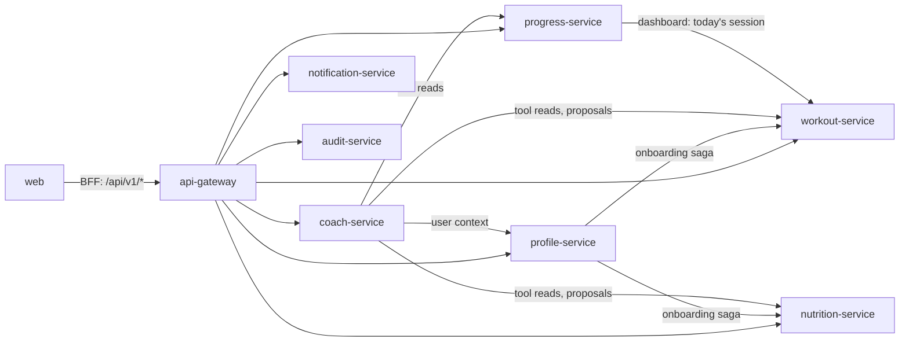
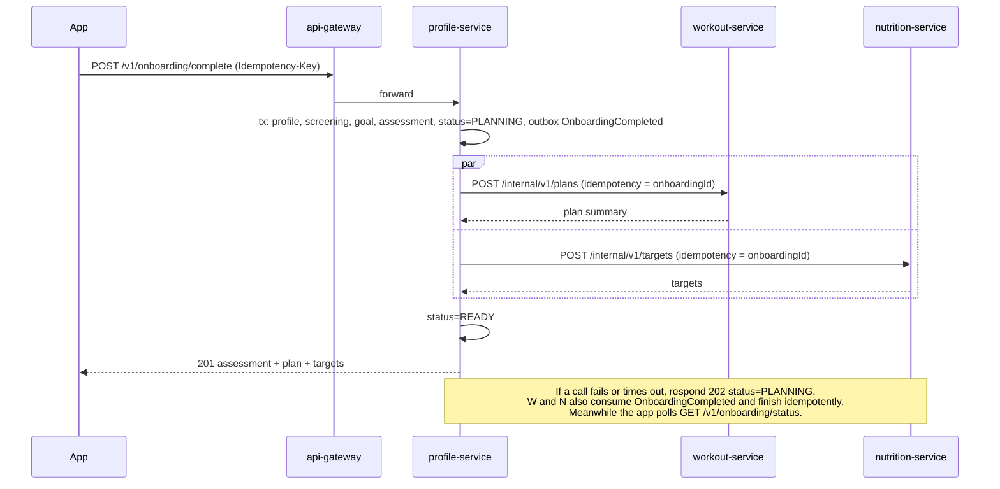

# Service Catalog

AuraCoach runs as **microservices in one repository**, following the same layout as `the-aura-lab`. Every backend service is its own NestJS app with its own database, Docker image, Helm release and CI matrix job. Shared code lives in workspace packages. Decision: [ADR-001](ADR/ADR-001-microservices-monorepo.md).

## 1. Repository layout

```text
services/
  api-gateway/            nginx: behind the cluster ingress (Traefik on k3s, ALB on EKS), routing, request ids, rate limits
  profile-service/        users, profile, consents, screening, goals, assessment, onboarding saga, roles, privacy requests
  workout-service/        exercise library, templates, plans, sessions, sets, PRs, progression engine
  nutrition-service/      foods, recipes, targets, logs, meal plans, grocery lists, barcode lookup
  progress-service/       measurements, check-ins, dashboard and analytics read models, health integrations (P2)
  coach-service/          AI coach, AI gateway, prompts, model config, recommendations, safety review, AI usage
  notification-service/   devices, notification preferences, scheduling and delivery
  audit-service/          append-only audit log fed by events, audit search for admins
apps/
  web/                    Next.js: user web app, admin console, auth BFF
  mobile/                 Expo: iOS and Android
packages/
  contracts/              Zod DTOs, OpenAPI generation, event schemas (versioned)
  domain/                 pure engines: targets, plans, progression, units, trends (no I/O)
  service-kit/            NestJS building blocks: JWT + internal guards, problem details, pino, OTel, outbox, Redis Streams bus, idempotency, health
  api-client/             generated typed client for web and mobile
  ui/  ui-tokens/         design system
infra/
  terraform/              network, k3s node (Stage 1) or EKS (Stage 2), RDS, Redis, S3, Cognito, per-service tfvars
  helm/aura-service/      one generic chart used by every service
docs/
```

Each `services/<name>/` has `src/`, `prisma/` (own schema and migrations), `test/`, `Dockerfile`, `README.md` and `docs/` (HLD, LLD, API, DATABASE, FLOWS, TESTING), matching the aura-lab per-service doc convention.

## 2. Services

| Service | Owns (data) | Public API (via gateway) | Internal API | Publishes | Consumes | Background jobs |
|---|---|---|---|---|---|---|
| **api-gateway** | — | all `/v1/*` routes | — | — | — | — |
| **profile-service** | User, Profile, UserPreference, Consent, FitnessGoal, SafetyScreening, HealthCondition, FitnessAssessment, Onboarding, Role/UserRole, DataRequest, Subscription (P2) | `/v1/me*`, `/v1/onboarding/*`, `/v1/admin/roles`, `/v1/admin/users/*`, `/v1/admin/flags*` | `GET /internal/v1/users/{id}/context` | UserRegistered, ProfileChanged, ConsentChanged, OnboardingCompleted, ExportRequested, AccountDeletionRequested, AccountRestored, AccountDeleted, AuditEvent | ExportPartReady, UserDataPurged | privacy.jobs (due deletions, finish deletions, acknowledgement alerts, export expiry) |
| **workout-service** | Exercise library, Equipment, UserEquipment, templates, WorkoutPlan, weeks, sessions, sets, PRs, UserTrainingProfile (replica) | `/v1/exercises*`, `/v1/workout-plans*`, `/v1/workout-sessions*`, `/v1/admin/exercises*`, `/v1/admin/templates*` | `POST /internal/v1/plans` (onboarding), `GET /internal/v1/users/{id}/week`, `POST /internal/v1/proposals/{validate,apply}` | PlanCreated, PlanWeekReady, PlanAdjustmentProposed, WorkoutCompleted, SessionMissed, PersonalRecordSet, ContentPublished, ExportPartReady, UserDataPurged | ProfileChanged, OnboardingCompleted, CheckInSaved, ExportRequested, AccountDeletionRequested, AccountRestored, AccountDeleted | plans.weekly-adapt, sessions.mark-missed |
| **nutrition-service** | Foods, nutrients, units, recipes, NutritionTarget, MealPlan, MealEntry, WaterEntry, DailyNutritionSummary, UserNutritionProfile (replica) | `/v1/foods*`, `/v1/nutrition/*`, `/v1/meal-plans*`, `/v1/recipes/*`, `/v1/admin/foods*`, `/v1/admin/recipes*` | `POST /internal/v1/targets` (onboarding), `GET /internal/v1/users/{id}/day/{date}`, `GET /internal/v1/foods/search`, `POST /internal/v1/proposals/{validate,apply}` | TargetsSet, TargetChangeProposed, MealLogged, MealDeleted, WaterLogged, ContentPublished, ExportPartReady, UserDataPurged | ProfileChanged, OnboardingCompleted, MeasurementAdded, ExportRequested, AccountDeletionRequested, AccountRestored, AccountDeleted | nutrition.adapt-targets, foods.data-qa, composites.recompute |
| **progress-service** | BodyMeasurement, DailyCheckIn, DeviceIntegration, read models: WorkoutDayFact, NutritionDayFact | `/v1/progress/*`, `/v1/dashboard/today` | `GET /internal/v1/users/{id}/progress-summary` | MeasurementAdded, CheckInSaved, PlateauDetected, ExportPartReady, UserDataPurged | WorkoutCompleted, SessionMissed, PersonalRecordSet, MealLogged, MealDeleted, TargetsSet, PlanWeekReady, ExportRequested, AccountDeletionRequested, AccountRestored, AccountDeleted | progress.plateau-scan, integrations.sync (P2) |
| **coach-service** | CoachConversation, CoachMessage, Recommendation, CoachMemory, UserFeedback, SafetyReview, AiPromptVersion, AiModelConfig, CoachingPolicy, UsageRecord | `/v1/coach/*`, `/v1/recommendations*`, `/v1/admin/prompts*`, `/v1/admin/model-configs*`, `/v1/admin/policies*`, `/v1/admin/reviews/*`, `/v1/admin/feedback`, `/v1/admin/usage` | — | RecommendationCreated, RecommendationAccepted, SafetyFlagRaised, ExportPartReady, UserDataPurged | PlateauDetected, PlanAdjustmentProposed, TargetChangeProposed, PlanWeekReady, ConsentChanged, ExportRequested, AccountDeletionRequested, AccountRestored, AccountDeleted | coach.weekly-summary, ai.usage-rollup |
| **notification-service** | Device, NotificationPreference, Notification | `/v1/me/devices`, `/v1/notifications*`, `/v1/me/notification-preferences` | `POST /internal/v1/notifications` | NotificationSent, ExportPartReady, UserDataPurged | PlanWeekReady, WorkoutCompleted, MealLogged, RecommendationCreated, ConsentChanged, ExportRequested, AccountDeletionRequested, AccountRestored, AccountDeleted | notifications.plan, notifications.send, notifications.receipts |
| **audit-service** | AuditLog | `/v1/admin/audit` | — | ExportPartReady, UserDataPurged | AuditEvent (from every service), ExportRequested, AccountDeletionRequested, AccountRestored, AccountDeleted | audit.retention |

Recommendations (proposals) live in coach-service because both the coach and engine-driven nudges create them; the **owning** service validates and applies the change through its `/internal/v1/proposals/*` endpoints, so plan and target data never leave their owner.

## 3. Communication rules

1. **Clients only talk to the gateway.** Web and mobile see a single `/v1` API ([openapi.yaml](../api/openapi.yaml)); the gateway routes by path prefix.
2. **Synchronous calls** (internal REST, `/internal/v1/*`) only when the caller needs an answer to respond to a user: onboarding saga, coach tool reads, proposal validate/apply, dashboard composition. Every call has a timeout (≤ 2 s), one retry on idempotent reads, and a circuit breaker; callers degrade gracefully.
3. **Asynchronous events** for everything else: transactional outbox in the producer's DB → Redis Streams (one stream per event type, consumer group per consuming service). At-least-once delivery; consumers dedupe by event id (`ProcessedEvent` table). Event schemas are versioned in `packages/contracts/events` and contract-tested. [ADR-009](ADR/ADR-009-service-communication.md).
4. **No shared tables, no cross-database queries.** A service that needs another's data either keeps a replica built from events (e.g. `UserNutritionProfile`) or calls the owner's internal API.
5. **Service-to-service auth**: short-lived service JWTs (5 min, signed with a per-environment key in Secrets Manager, `aud` = target service) via `InternalServiceGuard`, plus Kubernetes NetworkPolicies that only allow the documented callers. The end user's id travels in the signed token's `sub_user` claim, never in a plain header.

## 4. Allowed synchronous dependencies



Any new arrow needs an ADR update. Cycles are not allowed. The Helm values (`global.callGraph` in `infra/helm/values/common.yaml`) mirror these arrows; they generate `INTERNAL_SERVICE_URLS`, the gateway's upstreams and the Kubernetes NetworkPolicies, and CI (`tools/ci/check-network-policies.mjs`) fails when the two differ. The `web` arrow is the Next.js BFF forwarding to the gateway (ADR-002); the mobile app reaches the gateway from outside the cluster.

## 5. Data stores

- One Amazon RDS PostgreSQL 16 instance (Multi-AZ) in MVP, with **one database and one DB user per service** (`profile_db`, `workout_db`, …). A user can reach only its own database. Heavy services can move to their own instance without code changes.
- One ElastiCache Redis cluster with ACL users per service and key prefixes; Redis Streams for events, BullMQ for each service's jobs.
- S3 buckets: `exercise-media` (public via CloudFront, workout-service writes), `user-private` (exports, P2 photos; prefix per service with IAM-scoped access).

Schemas per service: `services/<name>/prisma/schema.prisma`, with migrations next to them.

## 6. Cross-service flows

### 6.1 Onboarding (saga, orchestrated by profile-service)



### 6.2 Coach tool call

coach-service reads via internal APIs with a service token whose `sub_user` is the conversation owner; workout/nutrition re-check that the requested resource belongs to that user. Proposals: coach-service calls `POST /internal/v1/proposals/validate` on the owner, stores the validated change set, and on accept calls `/apply` with the `basisVersion`; a stale basis returns 409.

### 6.3 Account deletion and export

profile-service publishes `AccountDeletionRequested` (notification-service stops sends immediately) and, after the grace period, `AccountDeleted`; every service deletes its rows for that user and acknowledges with `UserDataPurged{service}`; profile-service tracks completion and alerts if any service has not acknowledged within 24 h. Export works the same way with `ExportRequested` → each service writes its part to `user-private/{userId}/exports/{requestId}/{service}.json` → `ExportPartReady` → profile-service zips when all parts arrive. While deletion is pending every service keeps an `AccountState` replica (from `AccountDeletionRequested`/`AccountRestored`, newest event wins) and answers 423. Each service declares its tables in `src/user-data-plan.ts`; the shared contract suite in `@aura/testing` fails the build when a new table is not classified. See [users LLD §3–4](../modules/users/LLD.md#3-export).

## 7. Service ownership of engine code

The pure engines in `packages/domain` are shared libraries, but only the owning service executes writes with them: workout-service runs plan and progression engines, nutrition-service runs targets and meal-plan engines, progress-service runs trend and plateau calculations. Clients may use the same functions for offline previews only.
