# Entity Relationship Design

Source of truth: [schema.prisma](schema.prisma) (draft, validated with `prisma validate`). Field-level detail: [data-dictionary.md](data-dictionary.md).

## 1. Ownership model

Every user-owned table carries `userId` with `ON DELETE CASCADE` from `User`. Content tables (exercises, foods, recipes, templates) are global and owned by the admin workflow. Operational tables (`UsageRecord`, `AuditLog`) keep a nullable or pseudonymous user reference so they survive deletion without personal data.

## 2. Core ERD

```mermaid
erDiagram
  User ||--o| Profile : has
  User ||--o| UserPreference : has
  User ||--o{ UserRole : has
  Role ||--o{ UserRole : grants
  Role ||--o{ RolePermission : includes
  Permission ||--o{ RolePermission : in
  User ||--o{ Consent : gives
  User ||--o{ FitnessGoal : sets
  User ||--o{ SafetyScreening : completes
  User ||--o{ HealthCondition : declares
  User ||--o{ FitnessAssessment : receives
  User ||--o{ UserEquipment : owns
  Equipment ||--o{ UserEquipment : is

  User ||--o{ WorkoutPlan : follows
  WorkoutTemplate ||--o{ WorkoutPlan : seeds
  WorkoutTemplate ||--o{ WorkoutTemplateExercise : contains
  WorkoutPlan ||--o{ WorkoutPlanWeek : spans
  WorkoutPlanWeek ||--o{ WorkoutSession : schedules
  User ||--o{ WorkoutSession : performs
  WorkoutSession ||--o{ PlannedExercise : prescribes
  WorkoutSession ||--o{ WorkoutSet : records
  Exercise ||--o{ WorkoutSet : of
  Exercise ||--o{ PlannedExercise : of
  Exercise ||--o{ ExerciseMuscle : targets
  MuscleGroup ||--o{ ExerciseMuscle : in
  Exercise ||--o{ ExerciseEquipment : needs
  Exercise ||--o{ ExerciseMedia : shows
  User ||--o{ PersonalRecord : achieves

  FoodItem ||--o{ FoodNutrient : has
  Nutrient ||--o{ FoodNutrient : measured
  FoodItem ||--o{ FoodUnit : measured_in
  FoodItem |o--o{ FoodItem : cooked_from
  Recipe ||--o{ RecipeIngredient : uses
  FoodItem ||--o{ RecipeIngredient : is
  Recipe |o--o| FoodItem : as_composite
  User ||--o{ NutritionTarget : has
  User ||--o{ MealPlan : follows
  MealPlan ||--o{ MealPlanItem : contains
  Recipe ||--o{ MealPlanItem : planned
  User ||--o{ MealEntry : logs
  FoodItem ||--o{ MealEntry : logged
  User ||--o{ WaterEntry : logs
  User ||--o{ DailyNutritionSummary : summarised

  User ||--o{ BodyMeasurement : records
  User ||--o{ DailyCheckIn : checks_in

  User ||--o{ CoachConversation : chats
  CoachConversation ||--o{ CoachMessage : contains
  CoachMessage ||--o{ Recommendation : proposes
  User ||--o{ Recommendation : receives
  User ||--o{ CoachMemory : approves
  User ||--o{ UserFeedback : gives

  User ||--o{ Device : uses
  User ||--o{ Notification : receives
  User ||--o{ DeviceIntegration : connects
  User ||--o{ Subscription : pays
  User |o--o{ UsageRecord : consumes
  User ||--o{ DataRequest : requests
```

## 3. Constraints added in migration SQL

Prisma cannot express these; they live in the reviewed migration files.

| Object | SQL |
|---|---|
| One active plan per user | `CREATE UNIQUE INDEX workout_plan_one_active ON "WorkoutPlan"("userId") WHERE status = 'ACTIVE';` |
| One active meal plan per week | `CREATE UNIQUE INDEX meal_plan_one_active ON "MealPlan"("userId","weekStart") WHERE status = 'ACTIVE';` |
| Food search | `CREATE INDEX food_name_trgm ON "FoodItem" USING gin (unaccent_immutable(name) gin_trgm_ops);` plus `localNames` via `array_to_string` immutable wrapper |
| Exercise search | trigram on `Exercise.name` |
| Meal entry has food or manual name | `CHECK ("foodId" IS NOT NULL OR "manualName" IS NOT NULL)` |
| Ranges | `CHECK (rpe BETWEEN 1 AND 10)`, `CHECK (reps BETWEEN 0 AND 100)`, `CHECK ("loadKg" >= 0)`, `CHECK (soreness BETWEEN 1 AND 5)`, `CHECK (ml BETWEEN 1 AND 5000)` |
| Profile ranges | `CHECK ("heightCm" BETWEEN 100 AND 250)` |
| Measurement ranges | per type via `CHECK` on (type, value) |
| Audit append-only | `REVOKE UPDATE, DELETE ON "AuditLog" FROM app_rw;` |
| Partitioning (later) | `UsageRecord` and `AuditLog` range-partitioned by month once > 50 M rows |

## 4. Transaction boundaries

| Operation | Transaction scope |
|---|---|
| Finish onboarding | Profile + screening + conditions + goal + assessment + plan (+weeks, sessions, planned exercises) + nutrition target, single transaction |
| Complete session | Session status + sets upsert + PR detection; `WorkoutCompleted` event emitted after commit (outbox) |
| Log meal | MealEntry insert + DailyNutritionSummary upsert (`SELECT … FOR UPDATE` on summary row) |
| Accept recommendation | Re-validate against current `basisVersion`, apply change set, mark ACCEPTED; reject with 409 if basis changed |
| Publish content | Version bump + status + audit log in one transaction; cache invalidation after commit |

Domain events use a transactional **outbox** table (`OutboxEvent`) polled by the worker, so notifications and summaries never fire for rolled-back writes.

## 5. Migration strategy

- `prisma migrate dev` locally; generated SQL reviewed and edited (constraints above) and committed.
- CI runs `prisma migrate diff` to catch drift, then applies migrations to a Testcontainers Postgres and runs integration tests.
- Expand → migrate data (worker backfill job, idempotent, batched) → contract in a later release.
- No destructive migration without a backup checkpoint and a reviewed rollback note in the PR.
- Seed data (`muscle groups`, `equipment`, `nutrients`, `allergens`, `roles/permissions`) as versioned idempotent seed scripts; content (exercises, foods) via admin import pipelines, not migrations.
