# Entity Relationship Design

Source of truth: one Prisma schema per service in [services/](services/) (drafts, each validated with `prisma validate`): [profile](services/profile.prisma) · [workout](services/workout.prisma) · [nutrition](services/nutrition.prisma) · [progress](services/progress.prisma) · [coach](services/coach.prisma) · [notification](services/notification.prisma) · [audit](services/audit.prisma). Field-level detail: [data-dictionary.md](data-dictionary.md).

Each service owns one database. The diagram below is the **logical** model across services; relationships that cross a service boundary are plain id columns (no foreign keys), kept consistent by events.

## 1. Ownership model

| Service | Tables |
|---|---|
| profile | User, Profile, UserPreference, Role, UserRole, Consent, DataRequest, FitnessGoal, SafetyScreening, HealthCondition, FitnessAssessment, Onboarding, Subscription (P2) |
| workout | Equipment, UserEquipment, MuscleGroup, Exercise (+ muscles, equipment, media), WorkoutTemplate (+ exercises), WorkoutPlan, WorkoutPlanWeek, WorkoutSession, PlannedExercise, WorkoutSet, PersonalRecord, WorkoutPolicy; replicas UserTrainingProfile, RecoverySignal |
| nutrition | Nutrient, Allergen, FoodItem, FoodNutrient, FoodUnit, Recipe, RecipeIngredient, NutritionTarget, MealPlan, MealPlanItem, MealEntry, WaterEntry, DailyNutritionSummary, NutritionPolicy; replicas UserNutritionProfile, WeightFact |
| progress | BodyMeasurement, DailyCheckIn, DeviceIntegration; read models WorkoutDayFact, NutritionDayFact, ExerciseBestFact |
| coach | CoachConversation, CoachMessage, Recommendation, CoachMemory, UserFeedback, SafetyReview, AiPromptVersion, AiModelConfig, CoachingPolicy, UsageRecord; replica UserConsentState |
| notification | Device, NotificationPreference, Notification, SuppressionFact |
| audit | AuditLog |

Every service also has `OutboxEvent` and `ProcessedEvent` ([ADR-009](../architecture/ADR/ADR-009-service-communication.md)).

Inside profile-service, user-owned tables cascade from `User`. In every other service, user-owned tables carry a plain `userId` and are deleted by that service's `AccountDeleted` handler. Content tables (exercises, foods, recipes, templates) are global and owned by the admin workflow. Operational tables (`UsageRecord`, `AuditLog`) keep a nullable or pseudonymous user reference so they survive deletion without personal data.

## 2. Logical ERD (across services)

```mermaid
erDiagram
  User ||--o| Profile : has
  User ||--o| UserPreference : has
  User ||--o{ UserRole : has
  Role ||--o{ UserRole : grants
  User ||--o{ Consent : gives
  User ||--o{ FitnessGoal : sets
  User ||--o{ SafetyScreening : completes
  User ||--o{ HealthCondition : declares
  User ||--o{ FitnessAssessment : receives
  User ||--o{ UserEquipment : owns
  Equipment ||--o{ UserEquipment : is

  User ||--o{ WorkoutPlan : follows
  WorkoutTemplate ||--o{ WorkoutPlan : seeds
  WorkoutTemplate ||--o{ WorkoutTemplateExercise : contains
  WorkoutPlan ||--o{ WorkoutPlanWeek : spans
  WorkoutPlanWeek ||--o{ WorkoutSession : schedules
  User ||--o{ WorkoutSession : performs
  WorkoutSession ||--o{ PlannedExercise : prescribes
  WorkoutSession ||--o{ WorkoutSet : records
  Exercise ||--o{ WorkoutSet : of
  Exercise ||--o{ PlannedExercise : of
  Exercise ||--o{ ExerciseMuscle : targets
  MuscleGroup ||--o{ ExerciseMuscle : in
  Exercise ||--o{ ExerciseEquipment : needs
  Exercise ||--o{ ExerciseMedia : shows
  User ||--o{ PersonalRecord : achieves

  FoodItem ||--o{ FoodNutrient : has
  Nutrient ||--o{ FoodNutrient : measured
  FoodItem ||--o{ FoodUnit : measured_in
  FoodItem |o--o{ FoodItem : cooked_from
  Recipe ||--o{ RecipeIngredient : uses
  FoodItem ||--o{ RecipeIngredient : is
  Recipe |o--o| FoodItem : as_composite
  User ||--o{ NutritionTarget : has
  User ||--o{ MealPlan : follows
  MealPlan ||--o{ MealPlanItem : contains
  Recipe ||--o{ MealPlanItem : planned
  User ||--o{ MealEntry : logs
  FoodItem ||--o{ MealEntry : logged
  User ||--o{ WaterEntry : logs
  User ||--o{ DailyNutritionSummary : summarised

  User ||--o{ BodyMeasurement : records
  User ||--o{ DailyCheckIn : checks_in

  User ||--o{ CoachConversation : chats
  CoachConversation ||--o{ CoachMessage : contains
  CoachMessage ||--o{ Recommendation : proposes
  User ||--o{ Recommendation : receives
  User ||--o{ CoachMemory : approves
  User ||--o{ UserFeedback : gives

  User ||--o{ Device : uses
  User ||--o{ Notification : receives
  User ||--o{ DeviceIntegration : connects
  User ||--o{ Subscription : pays
  User |o--o{ UsageRecord : consumes
  User ||--o{ DataRequest : requests
```

## 3. Constraints added in migration SQL

Prisma cannot express these; they live in the reviewed migration files.

| Object | SQL |
|---|---|
| One active plan per user (workout) | `CREATE UNIQUE INDEX workout_plan_one_active ON "WorkoutPlan"("userId") WHERE status = 'ACTIVE';` |
| One active meal plan per week (nutrition) | `CREATE UNIQUE INDEX meal_plan_one_active ON "MealPlan"("userId","weekStart") WHERE status = 'ACTIVE';` |
| Food search | `CREATE INDEX food_name_trgm ON "FoodItem" USING gin (unaccent_immutable(name) gin_trgm_ops);` plus `localNames` via `array_to_string` immutable wrapper |
| Exercise search | trigram on `Exercise.name` |
| Meal entry has food or manual name | `CHECK ("foodId" IS NOT NULL OR "manualName" IS NOT NULL)` |
| Ranges | `CHECK (rpe BETWEEN 1 AND 10)`, `CHECK (reps BETWEEN 0 AND 100)`, `CHECK ("loadKg" >= 0)`, `CHECK (soreness BETWEEN 1 AND 5)`, `CHECK (ml BETWEEN 1 AND 5000)` |
| Profile ranges | `CHECK ("heightCm" BETWEEN 100 AND 250)` |
| Measurement ranges | per type via `CHECK` on (type, value) |
| Audit append-only (audit) | `REVOKE UPDATE, DELETE ON "AuditLog" FROM app_rw;` |
| Partitioning (later) | `UsageRecord` and `AuditLog` range-partitioned by month once > 50 M rows |

## 4. Transaction and consistency boundaries

Transactions never span services. Each row below is one local transaction that also writes its outbox event.

| Operation | Service and local transaction | Cross-service consistency |
|---|---|---|
| Finish onboarding | profile: profile + screening + conditions + goal + assessment + `OnboardingCompleted` | workout creates plan, nutrition creates targets (sync call, idempotent on onboarding id, event as fallback) |
| Complete session | workout: session status + sets + PRs + `WorkoutCompleted` | progress and notification update from the event |
| Log meal | nutrition: MealEntry + DailyNutritionSummary (`FOR UPDATE` on the summary row) + `MealLogged` | progress updates its day fact |
| Accept recommendation | coach: status `ACCEPTING` → owner `/apply` (checks `basisVersion`, applies, emits) → coach marks `ACCEPTED`; 409 → `INVALIDATED` | retried idempotently by proposal id if coach crashes mid-way |
| Publish content | owning service: version bump + status + `ContentPublished` + `AuditEvent` | cache invalidation in the same service, audit-service stores the event |
| Delete account | each service: delete user rows + `UserDataPurged` | profile tracks acknowledgements |

## 5. Migration strategy

- Migrations are per service (`services/<name>/prisma/migrations`) and run by that service's Helm pre-upgrade job; no migration touches another service's database.
- `prisma migrate dev` locally; generated SQL reviewed and edited (constraints above) and committed.
- CI runs `prisma migrate diff` to catch drift, then applies migrations to a Testcontainers Postgres and runs integration tests.
- Expand → migrate data (worker backfill job, idempotent, batched) → contract in a later release.
- No destructive migration without a backup checkpoint and a reviewed rollback note in the PR.
- Seed data (`muscle groups`, `equipment`, `nutrients`, `allergens`, `roles`) as versioned, per owning service, idempotent seed scripts; content (exercises, foods) via admin import pipelines, not migrations.
