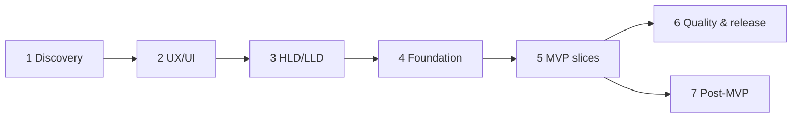

# Phased Delivery Plan

Each phase ends with a review gate: the product owner approves the listed deliverables before the next phase starts. Sizing assumes a team of ~4 engineers + 1 designer + part-time trainer/nutrition reviewer, in 2-week sprints; it is an indicative estimate to be re-planned after Phase 2.

## Phase 1 — Discovery (this PR)

| | |
|---|---|
| Deliverables | [Discovery report](../discovery/discovery-report.md), [PRD](../requirements/product-requirements.md), [user stories](../requirements/user-stories.md), [acceptance criteria](../requirements/acceptance-criteria.md), personas |
| Dependencies | Product owner answers to the 3 open questions |
| Risks | Assumed market/monetisation wrong → scope change |
| Decisions | MVP scope, deferred features, success metrics |
| Acceptance | Owner signs off scope, metrics and open questions |

## Phase 2 — UX/UI (1–2 sprints)

| | |
|---|---|
| Deliverables | Validated journeys and IA (this PR, draft), low-fi wireframes (this PR), interactive high-fidelity prototype for the 14 primary screens in light and dark, design tokens JSON, component inventory, accessibility annotations, content style guide, 5–6 user tests with target personas |
| Dependencies | Phase 1 sign-off; brand name/logo decision |
| Risks | Logging flow too slow → test "log 2 rotis + dal" under 10 s |
| Decisions | Navigation model, chart types, tone of voice, onboarding length |
| Acceptance | ≥ 4 of 5 testers complete onboarding and log a meal unaided; a11y review passes; owner approves hi-fi |

### Phase 2 progress

| Increment | Status |
|---|---|
| Journeys, IA, design system, low-fi wireframes | Done |
| High-fidelity designs for the 14 primary screens on mobile and web, light and dark ([TAC-3](https://harisireddi7776.atlassian.net/browse/TAC-3), [hifi-designs.md](../ux/hifi-designs.md)), tokens JSON, component inventory | Approved 2026-10-12 |
| Content style guide ([TAC-15](https://harisireddi7776.atlassian.net/browse/TAC-15), [content-style-guide.md](../ux/content-style-guide.md)), i18n-ready strings for web and mobile | Done |
| User tests with 5–6 target users | Not started |

## Phase 3 — HLD and LLD (in parallel with Phase 2, 1 sprint)

| | |
|---|---|
| Deliverables | HLD, 9 ADRs, service catalog, security and deployment architecture, module LLDs, per-service Prisma schemas, ERD, data dictionary, OpenAPI contract, test strategy (all drafted in this PR) |
| Dependencies | Phase 1 decisions (market drives residency; monetisation drives billing module) |
| Risks | Cognito UX limits; AI cost per user |
| Decisions | ADR-001…009 accepted or amended (ADR-001 microservices accepted 2026-10-11) |
| Acceptance | Owner + one external reviewer approve ADRs; OpenAPI and schema validated in CI |

## Phase 4 — Foundation (2 sprints)

| | |
|---|---|
| Deliverables | pnpm + Turborepo monorepo (`services/*`, `apps/web`, `apps/mobile`, `packages/*`); strict TS, ESLint (+ boundaries), Prettier, Husky + commitlint; `packages/service-kit` (config, pino logging, OTel, Problem Details, health, auth guards, `InternalClient`, outbox relay and stream consumer); all 7 service skeletons generated from one template, each with its own database, baseline migration and seeds, plus the nginx gateway; one end-to-end event (`UserRegistered` profile → notification) proving outbox, stream, dedupe and DLQ; Docker Compose local stack (one Postgres with a database per service); Cognito + BFF auth end-to-end; Expo app shell with auth and tabs; Next.js shell with auth and admin layout; GitHub Actions with changed-service detection (lint, typecheck, unit, integration with Testcontainers, contract tests, CodeQL, gitleaks, Trivy, per-service image build); generic Helm chart and Terraform `platform` + `service` stacks for the dev k3s node (Stage 1 of ADR-007); EAS dev builds; `AGENTS.md`/`CLAUDE.md`; operations docs (local development, deployment, monitoring, troubleshooting) |
| Dependencies | AWS accounts, Apple/Google developer accounts, domain |
| Risks | Expo + monorepo tooling friction (Metro config); Kubernetes and seven services is more platform work than one API, so the chart and template come first |
| Acceptance | A user can sign up and see an empty "Today" on web, iOS simulator and Android emulator in dev; CI green and only changed services build; every service is healthy in dev; `docker compose up` + `pnpm dev` works from a clean clone |

### Phase 4 progress

| Increment | Status |
|---|---|
| Monorepo, `packages/contracts`, `packages/service-kit`, 7 service skeletons with their databases, nginx gateway, docker compose stack, first event (`UserRegistered` profile → notification), CI with change detection ([TAC-1](https://harisireddi7776.atlassian.net/browse/TAC-1)) | Done |
| Web (Next.js) and mobile (Expo) shells, sign-in through the BFF and PKCE against dev-auth, `packages/ui-tokens` and `packages/api-client`, web Playwright smoke in CI ([TAC-2](https://harisireddi7776.atlassian.net/browse/TAC-2)) | Done |
| Hosting revision: k3s on EC2 for beta, EKS for growth ([TAC-4](https://harisireddi7776.atlassian.net/browse/TAC-4), ADR-007) | Done |
| Generic Helm chart `aura-service`, `aura-platform` and non-prod `aura-datastores` charts, values for all 9 deployables × dev/staging/prod, k3s add-on values, CI validation (kubeconform, kube-linter, NetworkPolicy vs catalog) and [deployment](../operations/deployment.md) doc; validated, never applied ([TAC-35](https://harisireddi7776.atlassian.net/browse/TAC-35)) | Done |
| Terraform `platform` stack for Stage 1 (prod and nonprod accounts, state backend, CI fmt/validate/tflint/checkov, plan once credentials exist), validated but not applied; [infrastructure](../operations/infrastructure.md) runbook ([TAC-36](https://harisireddi7776.atlassian.net/browse/TAC-36)) | Done |
| CD pipelines: signed arm64 images, Helm deploy per changed deployable, release with staging gates and prod approval, rollback, cluster add-ons ([ADR-010](../architecture/ADR/ADR-010-cd-helm-cli.md)); off until the owner sets `CD_ENABLED` ([TAC-37](https://harisireddi7776.atlassian.net/browse/TAC-37)) | Done (not enabled) |
| OpenTelemetry tracing, metrics and log correlation in every service, local Grafana stack, [monitoring](../operations/monitoring.md) doc ([TAC-5](https://harisireddi7776.atlassian.net/browse/TAC-5)) | Done |
| EAS dev builds, remaining operations docs (troubleshooting) | Not started |

## Phase 5 — MVP vertical slices (≈ 8–10 sprints)

Each slice ships API + web + mobile + tests + docs, behind a feature flag, and is demoed.

| # | Slice | Key acceptance (see test cases) | Depends on |
|---|---|---|---|
| 5.1 | Authentication and profile | TC-SEC-3/4, TC-PRV-1..4, settings screens, export/delete | Phase 4 |
| 5.2 | Goals and onboarding | TC-ONB-1..6, plan-reveal screen, starting assessment | 5.1, content: 120 exercises, 12 templates |
| 5.3 | Workout plans and session tracking | TC-WO-1..11, offline logging, rest timer, substitutions, weekly adaptation job | 5.2 |
| 5.4 | Nutrition targets, food logging, meal plans | TC-NU-1..13, 800 Indian dishes + IFCT/FDC import, barcode, grocery list | 5.2, nutrition reviewer |
| 5.5 | AI coach with validated recommendations | TC-CO-1..12, eval suite thresholds, safety review queue, cost dashboard | 5.3, 5.4 |
| 5.6 | Progress tracking and dashboard | Trends, PRs, plateau proposals, Today dashboard budgets | 5.3, 5.4 |
| 5.7 | Notifications (+ integrations P2) | TC-NO-1..6, preferences, weekly summary | 5.6 |
| 5.x | Admin console (incrementally per slice) | Content workflow, audit, roles | each slice |

### Phase 5 progress

| Increment | Status |
|---|---|
| 5.1a Profile, preferences and consents API (`ProfileChanged`, `ConsentChanged`, internal user context), Settings screen on web and mobile behind `settings_v1` ([TAC-6](https://harisireddi7776.atlassian.net/browse/TAC-6)) | Done |
| 5.1b Data export and account deletion/restore across services (TC-PRV-1..3), web and mobile behind `privacy_v1` ([TAC-7](https://harisireddi7776.atlassian.net/browse/TAC-7)) | Done |
| 5.1c Email sign-up, verification, password reset, password sign-in and sign out of all devices on web and mobile; Google/Apple buttons when configured ([TAC-8](https://harisireddi7776.atlassian.net/browse/TAC-8)) | Done (real Cognito pool and IdP apps come with the Terraform ticket) |

Risks: content creation is on the critical path (exercises, media, Indian dishes) → start content production during Phase 4 with the admin import tooling first.

## Phase 6 — Quality and release (2 sprints)

| | |
|---|---|
| Deliverables | Full regression, k6 load at 3× expected beta traffic, ZAP DAST, external pentest, accessibility audit (WCAG 2.2 AA web, VoiceOver/TalkBack), AI red-team run, privacy notice + DPDP consent review by counsel, App Store/Play listings and privacy labels, staging→prod runbooks, rollback rehearsal, on-call rota, support macros |
| Acceptance | All TC-E2E pass on web/iOS/Android; no critical/high findings open; SLO dashboards and alerts live; closed beta of 200 users with crash-free sessions ≥ 99.5% |

## Phase 7 — Post-MVP (prioritised backlog)

1. Apple Health / Health Connect.
2. Progress photos (consented, private).
3. Meal-photo recognition (suggestions only).
4. Subscriptions (App Store, Play Billing, Razorpay) if monetisation enabled.
5. Hindi and regional languages.
6. Wearables beyond the platform health stores.

## Cross-phase governance

- Definition of Done per [brief §14](../README.md#definition-of-done).
- Weekly demo; ADR for any decision that changes architecture; docs updated in the same PR as code.
- Metrics review after each slice against discovery success metrics.
