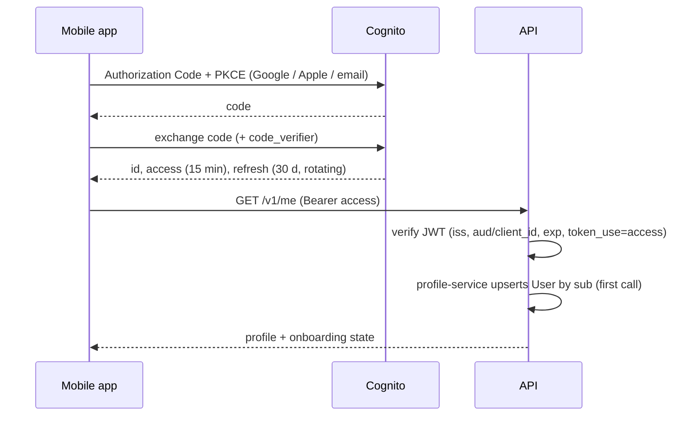

# Authentication and Authorisation — Low-Level Design

Service: **profile-service (user provisioning, roles) and `packages/service-kit` (guards used by every service)** · see the [service catalog](../../architecture/service-catalog.md) for owned data, events and allowed calls.

See [ADR-006](../../architecture/ADR/ADR-006-authentication.md) and [security architecture](../../architecture/security-architecture.md).

## 1. Components

```text
packages/service-kit/src/auth/       # used by every service
  jwt.strategy.ts                    # aws-jwt-verify, JWKS cached 1 h
  internal-service.guard.ts          # service JWTs for /internal/v1 routes
  guards/ jwt-auth.guard.ts permissions.guard.ts consent.guard.ts
  decorators/ public.ts permissions.ts current-user.ts internal.ts
  permission-map.ts                  # Cognito group → permission strings (from packages/contracts)
  service-token.client.ts            # mints outgoing service JWTs
services/profile-service/src/identity/
  user-provisioning.service.ts       # first-call User creation, publishes UserRegistered
  roles.service.ts                   # grants/revokes roles, mirrors to Cognito groups, audits
apps/web/app/api/auth/*              # BFF: login, callback, refresh, logout (Next.js route handlers)
apps/mobile/src/auth/                # expo-auth-session + expo-secure-store
```

Consent checks: profile-service publishes `ConsentChanged`; coach-service and notification-service keep a local consent replica so `ConsentGuard` needs no sync call.

## 2. Flows



Web: the same code flow handled by the BFF; cookies `__Host-session` (encrypted, HttpOnly, Secure, SameSite=Lax). BFF proxies `/api/v1/*` to the API attaching the bearer token, refreshing when < 60 s left.

Email sign-up and password reset use Cognito `SignUp`, `ConfirmSignUp`, `ForgotPassword`, `ConfirmForgotPassword` from our own screens (BFF on web, direct SDK on mobile). Reset codes expire in 15 min, single use.

Log out all devices: `POST /v1/me/sessions/revoke` → Cognito `GlobalSignOut` + API deny-list of `jti`/`origin_jti` in Redis until expiry.

## 3. Authorisation

- Default deny: every route requires auth unless `@Public()`.
- `@Permissions('exercise:publish')` checked by `PermissionsGuard` from the token's `cognito:groups` claim through the shared permission map. profile-service is the source of truth for grants and keeps Cognito groups in sync; a revoked role takes effect at the next token refresh (≤ 15 min), and role revocation also triggers `GlobalSignOut` for admin roles.
- Admin routes additionally require token `amr` to include MFA; else `403 MFA_REQUIRED`.
- Ownership in repositories; 404 for non-owned.
- Permission catalogue (MVP): `exercise:*`, `food:*`, `recipe:*`, `template:*`, `prompt:*`, `policy:*`, `review:*`, `feedback:read`, `usage:read`, `audit:read`, `role:grant`, `user:support_read`.

## 4. Errors

`401 UNAUTHENTICATED` (missing/invalid/expired token), `403 FORBIDDEN`, `403 MFA_REQUIRED`, `403 CONSENT_REQUIRED` (with `purpose`), `423 ACCOUNT_PENDING_DELETION`.

## 5. Tests

JWT verification with locally signed test keys (wrong issuer, audience, expired, `id` token instead of `access`); guard matrix generated from route metadata; BFF CSRF and cookie flags; refresh rotation; revoked token rejected.
