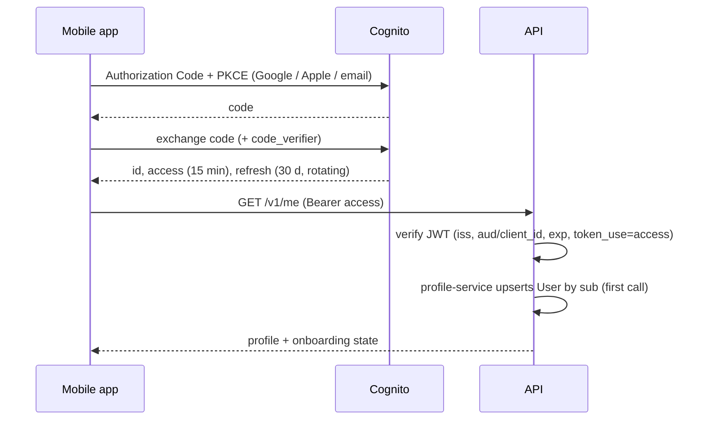

# Authentication and Authorisation — Low-Level Design

Service: **profile-service (user provisioning, roles) and `packages/service-kit` (guards used by every service)** · see the [service catalog](../../architecture/service-catalog.md) for owned data, events and allowed calls.

See [ADR-006](../../architecture/ADR/ADR-006-authentication.md) and [security architecture](../../architecture/security-architecture.md).

## 1. Components

```text
packages/service-kit/src/auth/       # used by every service
  user-token.verifier.ts             # jose: RS256 via the pool JWKS (cached 1 h), iss, exp, token_use, client_id
  auth.guard.ts                      # global: @Public() → open, @InternalOnly(...) → service token, else user token
  service-token.ts                   # mints and verifies service JWTs for /internal/v1 routes
  decorators.ts                      # Public, InternalOnly, CurrentUser, CallingService
  permissions.guard.ts               # AdminMfaGuard (MFA on /v1/admin/*) and PermissionsGuard (@Permissions)
  consent.guard.ts                   # ConsentGuard (@RequiresConsent) over the service's ConsentStateReader
  guard-matrix.ts                    # describeRoutes + guardMatrixViolations, run in every service's app test
packages/contracts/src/auth/permissions.ts   # roles, role → permission map, MFA methods; shared by all services
services/profile-service/src/identity/
  user-provisioning.service.ts       # first-call User creation, publishes UserRegistered
  me.controller.ts                   # GET /v1/me
  identity-groups.ts                 # AdminAddUserToGroup / AdminRemoveUserFromGroup (AWS SDK; dev-auth locally)
services/profile-service/src/roles/  # GET/POST/DELETE /v1/admin/roles: grants, Cognito groups, audit
apps/web/app/api/auth/*              # BFF: login, callback, refresh, logout (Next.js route handlers)
apps/mobile/src/auth/                # expo-auth-session + expo-secure-store
```

Consent checks: profile-service publishes `ConsentChanged`; coach-service and notification-service keep a local consent replica so `ConsentGuard` needs no sync call. A service that uses `@RequiresConsent(purpose)` provides a `ConsentStateReader` under `CONSENT_STATE` (coach-service: `UserConsentState`, updated only by newer events). Users the replica has never heard of count as not consented. Without a reader the guard fails closed with a 500.

## 2. Flows



Web: the same code flow handled by the BFF; cookies `__Host-session` (encrypted, HttpOnly, Secure, SameSite=Lax). BFF proxies `/api/v1/*` to the API attaching the bearer token, refreshing when < 60 s left.

Email sign-up and password reset use Cognito `SignUp`, `ConfirmSignUp`, `ForgotPassword`, `ConfirmForgotPassword` from our own screens (BFF on web, direct SDK on mobile). Reset codes expire in 15 min, single use.

Log out all devices: `POST /v1/me/sessions/revoke` → Cognito `GlobalSignOut` + API deny-list of `jti`/`origin_jti` in Redis until expiry.

## 3. User identity across services

The AuraCoach user id **is** the Cognito `sub` (a UUID). profile-service creates `User` with `id = sub` on the first call, and every other service keys its rows by the token's `sub` directly, so no service needs a lookup call to find "who is this". `User.cognitoSub` is stored separately so a future identity-provider migration can remap logins without changing ids. Access tokens must carry `email`, added by a Cognito pre-token-generation trigger (V2); without it profile-service refuses to create the account (`403 EMAIL_CLAIM_MISSING`). The verifier rejects tokens whose `sub` is not a UUID.

## 4. Authorisation

- Default deny: every route requires auth unless `@Public()`.
- Global guards run in this order: `AuthGuard` (user or service token) → `AdminMfaGuard` → `PermissionsGuard` → `ConsentGuard`, then ownership in repositories.
- `@Permissions('exercise:publish')` checked by `PermissionsGuard` from the token's `cognito:groups` claim through the shared permission map (the caller needs every listed permission). An admin route without `@Permissions` is refused, so a forgotten decorator fails closed.
- Every `/v1/admin/*` route (read from route metadata, not the URL): callers with no admin permission get `403 FORBIDDEN`; staff whose token `amr` has no MFA method (`mfa`, `otp`, `hwk`, `swk`) get `403 MFA_REQUIRED`; staff with MFA but without the route's permission get `403 FORBIDDEN` (TC-SEC-3).
- Ownership in repositories; 404 for non-owned.
- Permission catalogue (MVP): `exercise:*`, `food:*`, `recipe:*`, `template:*`, `prompt:*`, `policy:*`, `review:*`, `feedback:read`, `usage:read`, `audit:read`, `role:grant`, `user:support_read`.

### 4.1 Roles

`user` is implicit for every account and never stored. Staff roles are seeded by a profile-service migration:

| Role | Permissions |
|---|---|
| owner | all, including `prompt:*`, `policy:*`, `role:grant`, `audit:read`, `usage:read` |
| content_editor | `exercise:write`, `template:write`, `food:write`, `recipe:write` |
| content_reviewer | `exercise:review/publish`, `template:review/publish` |
| nutrition_reviewer | `food:review/publish`, `recipe:review/publish` |
| safety_reviewer | `review:read`, `review:resolve`, `feedback:read` |
| support | `user:support_read`, `feedback:read` |

### 4.2 Granting and revoking

`GET /v1/admin/roles` (roles with permissions, and every grant), `POST /v1/admin/roles {userId | email, role}` (201 granted, 200 already granted), `DELETE /v1/admin/roles/{userId}/{role}` (204). All need `role:grant` and MFA. profile-service is the source of truth. In one transaction it writes `UserRole`, writes an `AuditEvent` (`role.grant` / `role.revoke`, entity `user_role`) to the outbox and calls Cognito `AdminAddUserToGroup` / `AdminRemoveUserFromGroup` with the user's sub as username; if Cognito fails, nothing is committed (`503 IDENTITY_UNAVAILABLE`). The last owner cannot be removed (`409 LAST_OWNER`).

**A revoked role stays in tokens already issued until they expire.** Access tokens live 15 minutes and groups are re-read at refresh, so revocation takes effect within 15 minutes. Admin role revocation will also sign the user out everywhere (`GlobalSignOut`, with the sessions work in TAC-8) once that lands.

### 4.3 Admin MFA in production (Cognito TOTP)

Cognito does not put `amr` in access tokens itself, and a pool cannot require MFA for one group only. So staff sign in through a separate **staff user pool** with MFA set to **Required** and TOTP (software token) as the only factor, using its own app client for the web admin console:

1. Infra (Terraform, TAC-36): staff pool with `mfa_configuration = "ON"`, `software_token_mfa_configuration { enabled = true }`, advanced security on, no self sign-up; admin app client; the API accepts that pool's issuer and client id alongside the user pool.
2. Its pre-token-generation trigger (V2) adds `amr: ["pwd", "mfa"]` to access tokens: every successful sign-in to a pool with MFA required has passed the TOTP step.
3. Enrolment: an owner creates the staff user (`AdminCreateUser`, temporary password by email). At first sign-in Cognito's managed login asks them to set a password and scan the TOTP QR code (`AssociateSoftwareToken`, `VerifySoftwareToken`); after that every sign-in asks for the code. Lost device: an owner resets MFA with `AdminSetUserMFAPreference` and the user enrols again.
4. Role grants for staff mirror into the staff pool's groups (`COGNITO_USER_POOL_ID` of profile-service points at it).

To verify when the pools exist (TAC-36): Cognito accepts the sub as `Username` for the admin group calls, including federated users; the issuer list in every service contains both pools.

Locally, dev-auth asks staff (anyone with a group) for a code after the email step: `123456` (or `DEV_AUTH_MFA_CODE`) gives `amr: ["pwd","mfa"]`; **Skip** gives `["pwd"]`, which is how the `MFA_REQUIRED` path is tested by hand. The **Staff (admin console)** checkbox makes the person an `owner` in dev-auth, the local bootstrap; in production the first owner is granted by hand (Cognito console group + a `UserRole` row) as part of the launch runbook.

### 4.4 Guard matrix

Every service's `app.int.test.ts` reads all routes from Nest metadata (`describeRoutes`) and asserts `guardMatrixViolations` is empty: each route is `@Public` (only routes on a reviewed list, today just the health checks), `@InternalOnly` with callers and under `/internal/v1`, or user-authenticated; nothing under `/internal` lacks `@InternalOnly`; every `/v1/admin` route takes a user token and declares `@Permissions`; `@Permissions` and `@RequiresConsent` only appear on user-token routes.

## 5. Errors

`401 UNAUTHENTICATED` (missing/invalid/expired token), `403 FORBIDDEN`, `403 MFA_REQUIRED`, `403 CONSENT_REQUIRED` (with a `purpose` member, e.g. `AI_COACH`), `404 USER_NOT_FOUND` / `ROLE_GRANT_NOT_FOUND`, `409 LAST_OWNER`, `423 ACCOUNT_PENDING_DELETION`, `503 IDENTITY_UNAVAILABLE`.

## 6. Tests

JWT verification with locally signed test keys (wrong issuer, audience, expired, `id` token instead of `access`); guard matrix generated from route metadata; BFF CSRF and cookie flags; refresh rotation; revoked token rejected.
