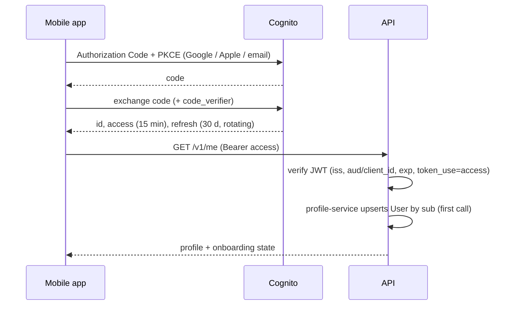

# Authentication and Authorisation — Low-Level Design

Service: **profile-service (user provisioning, roles) and `packages/service-kit` (guards used by every service)** · see the [service catalog](../../architecture/service-catalog.md) for owned data, events and allowed calls.

See [ADR-006](../../architecture/ADR/ADR-006-authentication.md) and [security architecture](../../architecture/security-architecture.md).

## 1. Components

```text
packages/service-kit/src/auth/       # used by every service
  user-token.verifier.ts             # jose: RS256 via the pool JWKS (cached 1 h), iss, exp, token_use, client_id
  auth.guard.ts                      # global: @Public() → open, @InternalOnly(...) → service token, else user token
  service-token.ts                   # mints and verifies service JWTs for /internal/v1 routes
  decorators.ts                      # Public, InternalOnly, CurrentUser, CallingService
  (Phase 5) permissions.guard.ts consent.guard.ts
packages/contracts/src/auth/permissions.ts   # role → permission map shared by all services
services/profile-service/src/identity/
  user-provisioning.service.ts       # first-call User creation, publishes UserRegistered
  me.controller.ts                   # GET /v1/me
  (Phase 5) roles.service.ts         # grants/revokes roles, mirrors to Cognito groups, audits
  identity/sessions.controller.ts    # POST /v1/me/sessions/revoke (sign out of all devices)
  identity/identity-provider.ts      # IdentityProvider port: GlobalSignOut via Cognito's API
packages/service-kit/src/auth/session-revocations.ts  # per-user revocation cut-off in Redis
packages/api-client/src/identity.ts  # Cognito user API client (sign-up, verify, reset, sign-in)
apps/web/app/api/auth/*              # BFF: login, callback, refresh, logout, email flows, logout-everywhere
apps/mobile/src/auth/                # expo-auth-session + expo-secure-store + email flows
```

Consent checks: profile-service publishes `ConsentChanged`; coach-service and notification-service keep a local consent replica so `ConsentGuard` needs no sync call.

## 2. Flows



Web: the same code flow handled by the BFF; cookies `__Host-session` (encrypted, HttpOnly, Secure, SameSite=Lax). BFF proxies `/api/v1/*` to the API attaching the bearer token, refreshing when < 60 s left.

### Email sign-up, sign-in and password reset (TAC-8)

Our own screens call Cognito's public user API (`cognito-idp` JSON protocol, app client id only, no AWS credentials): `SignUp`, `ConfirmSignUp`, `ResendConfirmationCode`, `ForgotPassword`, `ConfirmForgotPassword` and `InitiateAuth`. One fetch-based client, `createIdentityClient` in `packages/api-client`, serves both apps; dev-auth implements the same actions, so Cognito vs dev-auth is only the `IDENTITY_ENDPOINT` setting.

| Step | Web (BFF, `apps/web/src/lib/email-auth.ts`) | Mobile (`apps/mobile/src/auth/email-flows.ts`) |
|---|---|---|
| Sign up | `POST /api/auth/sign-up` → `SignUp`; email and Cognito's sign-up session go in a sealed `__Host-auth-pending` cookie (15 min) | `SignUp`; session kept in memory |
| Verify | `POST /api/auth/verify` → `ConfirmSignUp` (+ session) → `InitiateAuth USER_AUTH` with the new session → session cookies, lands on Today. Without the session (other browser): "confirmed, sign in" | Same; tokens go to `expo-secure-store` |
| Resend | `POST /api/auth/resend` → `ResendConfirmationCode` (old code stops working) | Same |
| Sign in | `POST /api/auth/sign-in` → `InitiateAuth USER_PASSWORD_AUTH`. "More sign-in options" still opens the hosted page | Same, plus the hosted flow |
| Forgot / reset | `POST /api/auth/forgot` (same answer for unknown emails) → `POST /api/auth/reset` → `ConfirmForgotPassword`; back to sign-in | Same |
| Google / Apple | `GET /api/auth/login?provider=Google` adds `identity_provider`; buttons only for providers in `IDENTITY_PROVIDERS` | `AuthRequest` with `extraParams.identity_provider`; `EXPO_PUBLIC_IDENTITY_PROVIDERS` |

- Password policy mirrors the pool: at least 10 characters with upper- and lower-case letters and a number (`PASSWORD_POLICY` in `packages/contracts`). Emails are trimmed and lower-cased before every call.
- Codes are six digits, valid 15 minutes, single use; five wrong guesses lock the code (`LimitExceeded`). dev-auth enforces the same rules and prints codes to its log and `GET /test/codes?email=` instead of emailing them.
- Errors come back as Cognito exception names without `Exception` (`UsernameExists`, `CodeMismatch`, `ExpiredCode`, `LimitExceeded`, `InvalidPassword`, `NotAuthorized`, `UserNotConfirmed`, …); `IDENTITY_ERROR_MESSAGES` in `packages/api-client` holds the copy both apps show.
- BFF auth routes (`login` and every email route) allow 10 requests a minute per client IP (429 + `Retry-After`), counted per web replica; the client IP is read `TRUSTED_PROXY_HOPS` entries from the right of `X-Forwarded-For`. All of them are same-origin POSTs (CSRF) and return only `{redirect}`, never tokens.
- Cognito pool settings these flows need (Terraform ticket): app client flows `ALLOW_USER_PASSWORD_AUTH`, `ALLOW_USER_AUTH`, `ALLOW_REFRESH_TOKEN_AUTH`; `PreventUserExistenceErrors` on; email verification by code; password policy as above.

### Sign out of all devices

`POST /v1/me/sessions/revoke` (profile-service) writes a per-user cut-off `auth:revoked-before:<sub>` (epoch seconds, 24 h TTL) to the shared Redis and then calls Cognito `GlobalSignOut` with the caller's token. The `AuthGuard` in every service rejects access tokens whose `iat` is at or before the cut-off, so tokens on other devices get 401 before they expire, and their refresh tokens no longer work. A cut-off rather than a deny-list of `jti`/`origin_jti`: the API never sees the token ids of the user's other devices, and one key per user covers them all. The guard fails closed when Redis is unreachable (readiness already reports Redis down). If `GlobalSignOut` fails the route answers `503 IDENTITY_UNAVAILABLE` (the cut-off stays) and the apps ask the user to retry. Web: Settings → "Sign out of all devices" (`POST /api/auth/logout-everywhere`); mobile: the same row in Settings.

## 3. User identity across services

The AuraCoach user id **is** the Cognito `sub` (a UUID). profile-service creates `User` with `id = sub` on the first call, and every other service keys its rows by the token's `sub` directly, so no service needs a lookup call to find "who is this". `User.cognitoSub` is stored separately so a future identity-provider migration can remap logins without changing ids. Access tokens must carry `email`, added by a Cognito pre-token-generation trigger (V2); without it profile-service refuses to create the account (`403 EMAIL_CLAIM_MISSING`). The verifier rejects tokens whose `sub` is not a UUID.

## 4. Authorisation

- Default deny: every route requires auth unless `@Public()`.
- `@Permissions('exercise:publish')` checked by `PermissionsGuard` from the token's `cognito:groups` claim through the shared permission map. profile-service is the source of truth for grants and keeps Cognito groups in sync; a revoked role takes effect at the next token refresh (≤ 15 min), and role revocation also triggers `GlobalSignOut` for admin roles.
- Admin routes additionally require token `amr` to include MFA; else `403 MFA_REQUIRED`.
- Ownership in repositories; 404 for non-owned.
- Permission catalogue (MVP): `exercise:*`, `food:*`, `recipe:*`, `template:*`, `prompt:*`, `policy:*`, `review:*`, `feedback:read`, `usage:read`, `audit:read`, `role:grant`, `user:support_read`.

## 5. Errors

`401 UNAUTHENTICATED` (missing/invalid/expired token), `403 FORBIDDEN`, `403 MFA_REQUIRED`, `403 CONSENT_REQUIRED` (with `purpose`), `423 ACCOUNT_PENDING_DELETION`.

## 6. Tests

JWT verification with locally signed test keys (wrong issuer, audience, expired, `id` token instead of `access`); guard matrix generated from route metadata; BFF CSRF and cookie flags; refresh rotation; revoked token rejected. TAC-8: dev-auth identity API (codes, expiry, single use, lockout, reset, GlobalSignOut), BFF email routes and rate limit, mobile flow logic against dev-auth, profile-service integration test that an unexpired token gets 401 after sign out of all devices, and Playwright sign-up → code → Today, reset, and two-browser sign-out.
