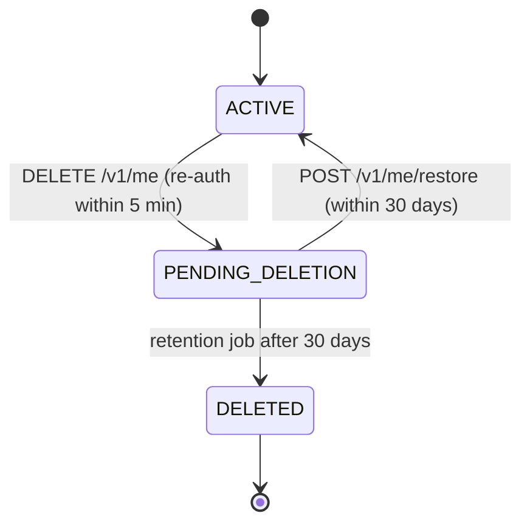

# Users, Profile, Consent and Privacy — Low-Level Design

## 1. Responsibilities

Profile and preferences, units, consents, data export, account deletion, devices.

## 2. Key rules

- `PATCH /v1/me/profile` validates ranges (height 100–250 cm, weight 25–350 kg, age ≥ 18). Changes to weight, activity, goal, equipment, training days or conditions emit `ProfileChanged{fields}`; workouts and nutrition respond with **proposals** (not silent re-plans).
- Consents are append-only rows; `GET /v1/me/consents` returns the latest per purpose; withdrawing `AI_COACH` closes open conversations for new messages and stops summary jobs.
- Weight changes go through `progress` (BodyMeasurement) — profile holds only height and static attributes.

## 3. Export

`POST /v1/me/exports` → `DataRequest(kind=export)` → worker gathers all owned tables via each module's `exportFor(userId)` → JSON (machine-readable) + CSVs zipped → S3 private, SSE-KMS → pre-signed URL (15 min) emailed and shown in app; artefact deleted after 7 days. Idempotent per day (one running export per user).

## 4. Deletion

Hard delete: Cognito `AdminDeleteUser`, S3 user prefix purge, DB cascade from `User`, `UsageRecord.userId` set null, audit entry with pseudonymous id. Push tokens removed immediately on request.

## 5. API

`GET /v1/me`, `PATCH /v1/me/profile`, `GET/PATCH /v1/me/preferences`, `GET/POST /v1/me/consents`, `POST /v1/me/exports`, `GET /v1/me/exports/{id}`, `DELETE /v1/me`, `POST /v1/me/restore`, `POST/DELETE /v1/me/devices`.

## 6. Tests

Export contains every owned table (test enumerates Prisma models with `userId` and asserts coverage); deletion cascade leaves no rows; restore within grace; consent withdrawal blocks coach.
