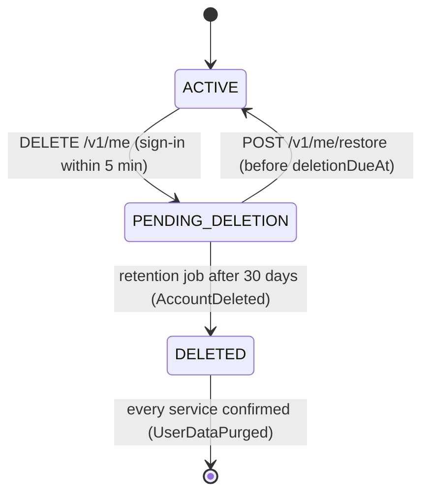

# Users, Profile, Consent and Privacy — Low-Level Design

Service: **profile-service** · see the [service catalog](../../architecture/service-catalog.md) for owned data, events and allowed calls.

## 1. Responsibilities

Profile and preferences, units, consents, roles, and the orchestration of data export and account deletion across all services. Devices and notification preferences belong to notification-service.

## 2. Key rules

- `PATCH /v1/me/profile` takes account fields (display name, time zone, locale) at any time and profile fields (height 100–250 cm, activity, experience, units, diet, cuisines, allergens, training days, session length 15–120 min, location, equipment) once onboarding has created the profile; before that profile fields return 409 `PROFILE_NOT_CREATED`. Date of birth (age ≥ 18) and sex are set in onboarding; weight goes through `progress`; goal and conditions change through the onboarding/goals slice (5.2). Validation failures are 422 problem documents naming each field.
- Values that other services copy (time zone, locale, height, activity, experience, diet, cuisines, allergens, training days, session length, location, equipment) publish one `ProfileChanged{fields, changes}` per request, in the same transaction, and only for values that actually changed. Display name and units stay in profile-service. Workouts and nutrition respond with **proposals** (not silent re-plans).
- Preferences (theme `system|light|dark`, coach tone `supportive|direct`) default until first saved; `PATCH /v1/me/preferences` upserts them.
- Consents are append-only rows with policy version and channel; `GET /v1/me/consents` returns the latest per purpose (purposes never answered are omitted and treated as not granted). Writes for one user are serialised (row lock on `User`) so "latest" is unambiguous. Every recorded consent publishes `ConsentChanged`. `CORE_SERVICE` cannot be withdrawn (409 `CORE_CONSENT_REQUIRED`); withdrawing it means deleting the account. Withdrawing `AI_COACH` closes open conversations for new messages and stops summary jobs (coach-service, slice 5.5).
- Consumers today: audit-service records `consent.grant` / `consent.withdraw` with purpose and policy version, and `profile.update` with field **names only**; notification-service copies the `NOTIFICATIONS` consent and time zone/locale. Both create their row if the event arrives before `UserRegistered`.
- Weight changes go through `progress` (BodyMeasurement) — profile holds only height and static attributes.

## 3. Export

`POST /v1/me/exports` → `DataRequest(kind=export, status=running)` with one `DataRequestPart` per participant → `ExportRequested {requestId, userId, exportPrefix}` → each of the six other services writes its part to `user-private/{userId}/exports/{requestId}/{service}.json` and emits `ExportPartReady {requestId, service, key, rows}` → when the last part arrives (row lock on the request, so it happens once) profile-service adds its own tables and writes `auracoach-export-YYYY-MM-DD.zip` next to the parts: `README.txt`, `json/{service}.json` and `csv/{service}/{Table}.csv` (cells starting with `= + - @` are prefixed with `'` so spreadsheets do not run them). Status becomes `ready`; `GET /v1/me/exports/{id}` and `GET /v1/me/exports` (latest five) return a pre-signed download URL valid for 15 minutes (`EXPORT_LINK_TTL_SECONDS`), generated on every read.

- One export at a time: a second POST while one is running answers 409 `EXPORT_IN_PROGRESS`; a POST within a day of a ready export returns that export (200) instead of a new one (202).
- Tables a service holds for the user but does not export say why in the plan (`notExported`), e.g. coach `SafetyReview` (moderator notes).
- Housekeeping job: ready exports are deleted after 7 days (`expired`), exports still running after 60 minutes are `failed` and their parts removed.
- Storage: S3 with SSE-KMS in AWS (`OBJECT_STORAGE=s3`, `S3_BUCKET`, `S3_KMS_KEY_ID`). Locally a shared directory stands in, with HMAC-signed links served by profile-service at `GET /v1/me/export-files` (public, refused in production).
- Not built yet: emailing the link (needs the email channel, notification slice).
- Works while the account is pending deletion, so a user can still take a copy.

## 4. Deletion

- **Request.** `DELETE /v1/me` needs a recent sign-in: the access token's `auth_time` must be under `REAUTH_MAX_AGE_SECONDS` (300) old, otherwise 403 `REAUTH_REQUIRED` and the client signs in again with `prompt=login&max_age=0`. It sets `PENDING_DELETION`, `deletionDueAt = now + 30 days`, records a queued `DataRequest(kind=delete)` and emits `AccountDeletionRequested`. Asking again returns the same date. Answers 202 `{deletionDueAt}`.
- **While pending.** Every service keeps an `AccountState` replica from `AccountDeletionRequested`/`AccountRestored` (the newer event wins, so redelivered or out-of-order events cannot undo a restore) and answers 423 `ACCOUNT_PENDING_DELETION` to the user's requests. profile-service still serves `GET /v1/me` (with `deletionDueAt`), exports, restore and sign-out; the apps show only a "scheduled for deletion" screen. notification-service stops sending at once and cancels scheduled notifications.
- **Restore.** `POST /v1/me/restore` before `deletionDueAt` sets the account active, cancels the request and emits `AccountRestored` (204). After the date: 409 `RESTORE_WINDOW_CLOSED`.
- **Hard delete (worker jobs, every `PRIVACY_JOB_INTERVAL_SECONDS`).** Due accounts become `DELETED`, the request becomes `running` with one part per service, and `AccountDeleted {userId, requestId}` goes out. Each service deletes the user's rows in its plan order and emits `UserDataPurged`. Exceptions kept on purpose: coach `UsageRecord` rows lose the user id (cost accounting), audit `AuditLog` rows keep only the pseudonymous id (snapshots and IP hash removed). When every part is confirmed profile-service deletes the sign-in identity (Cognito `AdminDeleteUser`; dev-auth locally), the whole `user-private/{userId}/` prefix and its own tables. The `User` row stays as a tombstone (`deleted-{id}@deleted.invalid`, no name) together with the `DataRequest` rows as the record of the erasure, so a still-valid token can never recreate the account.
- **Alert.** A deletion not confirmed by every service within `PURGE_ACK_ALERT_HOURS` (24) logs the missing services once and adds to `aura.privacy.purge_ack_missing`.

## 5. API

`GET /v1/me` (with `profile`, null before onboarding, `preferences` and `deletionDueAt`), `PATCH /v1/me/profile`, `GET/PATCH /v1/me/preferences`, `GET/POST /v1/me/consents`, `POST /v1/me/exports`, `GET /v1/me/exports`, `GET /v1/me/exports/{id}`, `DELETE /v1/me`, `POST /v1/me/restore`, `GET /v1/me/export-files` (local storage only). Internal: `GET /internal/v1/users/{id}/context` (`@InternalOnly('coach-service')`): `{userId, ageBand, unitSystem, timezone, locale, coachTone}`. The age band is five years wide (`30-34`; the first is `18-19`) and null before onboarding; no name, email or date of birth leaves the service.

## 6. Tests

Every participant runs the shared contract suite (`describeParticipantContract` in `@aura/testing`): the plan classifies every Prisma model, the export holds every exported table with only this user's rows, deletion leaves no rows and touches no one else's, the pending state follows the newest event, and a redelivered event changes nothing. `tests/e2e` boots all seven services and runs export → delete → 423 → grace over → purged everywhere. The web Playwright spec covers export download, delete, pending screen and restore. Consent withdrawal blocks coach (slice 5.5).
