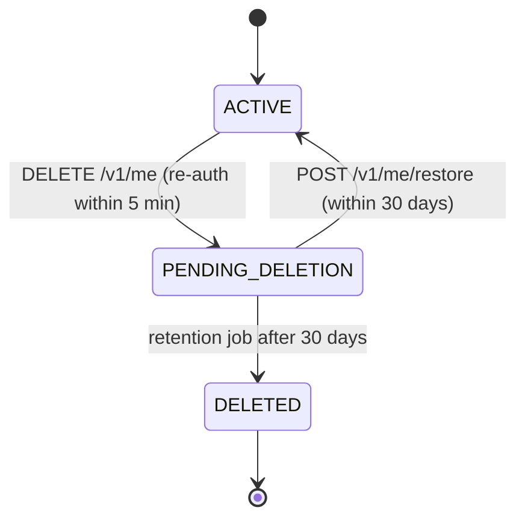

# Users, Profile, Consent and Privacy — Low-Level Design

Service: **profile-service** · see the [service catalog](../../architecture/service-catalog.md) for owned data, events and allowed calls.

## 1. Responsibilities

Profile and preferences, units, consents, roles, and the orchestration of data export and account deletion across all services. Devices and notification preferences belong to notification-service.

## 2. Key rules

- `PATCH /v1/me/profile` takes account fields (display name, time zone, locale) at any time and profile fields (height 100–250 cm, activity, experience, units, diet, cuisines, allergens, training days, session length 15–120 min, location, equipment) once onboarding has created the profile; before that profile fields return 409 `PROFILE_NOT_CREATED`. Date of birth (age ≥ 18) and sex are set in onboarding; weight goes through `progress`; goal and conditions change through the onboarding/goals slice (5.2). Validation failures are 422 problem documents naming each field.
- Values that other services copy (time zone, locale, height, activity, experience, diet, cuisines, allergens, training days, session length, location, equipment) publish one `ProfileChanged{fields, changes}` per request, in the same transaction, and only for values that actually changed. Display name and units stay in profile-service. Workouts and nutrition respond with **proposals** (not silent re-plans).
- Preferences (theme `system|light|dark`, coach tone `supportive|direct`) default until first saved; `PATCH /v1/me/preferences` upserts them.
- Consents are append-only rows with policy version and channel; `GET /v1/me/consents` returns the latest per purpose (purposes never answered are omitted and treated as not granted). Writes for one user are serialised (row lock on `User`) so "latest" is unambiguous. Every recorded consent publishes `ConsentChanged`. `CORE_SERVICE` cannot be withdrawn (409 `CORE_CONSENT_REQUIRED`); withdrawing it means deleting the account. Withdrawing `AI_COACH` closes open conversations for new messages and stops summary jobs (coach-service, slice 5.5).
- Consumers today: audit-service records `consent.grant` / `consent.withdraw` with purpose and policy version, and `profile.update` with field **names only**; notification-service copies the `NOTIFICATIONS` consent and time zone/locale. Both create their row if the event arrives before `UserRegistered`.
- Weight changes go through `progress` (BodyMeasurement) — profile holds only height and static attributes.

## 3. Export

`POST /v1/me/exports` → `DataRequest(kind=export)` → `ExportRequested` event → every service writes its part to `user-private/exports/{requestId}/{service}.json` and emits `ExportPartReady` → when all 6 parts are present, profile-service adds its own data and zips JSON (machine-readable) + CSVs → S3 private, SSE-KMS → pre-signed URL (15 min) emailed and shown in app; artefact deleted after 7 days. Idempotent per day (one running export per user).

## 4. Deletion

Hard delete: profile-service emits `AccountDeleted`; every service deletes its rows for that user (coach nulls `UsageRecord.userId`, audit keeps the pseudonymous id) and emits `UserDataPurged`; profile-service then runs Cognito `AdminDeleteUser`, purges the S3 prefix, cascades its own tables, and alerts if any service has not acknowledged within 24 h. `AccountDeletionRequested` makes notification-service stop sending immediately.

## 5. API

`GET /v1/me` (now with `profile`, null before onboarding, and `preferences`), `PATCH /v1/me/profile`, `GET/PATCH /v1/me/preferences`, `GET/POST /v1/me/consents`, `POST /v1/me/exports`, `GET /v1/me/exports/{id}`, `DELETE /v1/me`, `POST /v1/me/restore`. Internal: `GET /internal/v1/users/{id}/context` (`@InternalOnly('coach-service')`): `{userId, ageBand, unitSystem, timezone, locale, coachTone}`. The age band is five years wide (`30-34`; the first is `18-19`) and null before onboarding; no name, email or date of birth leaves the service.

## 6. Tests

Each service's export handler covers every one of its tables with `userId` (test enumerates its Prisma models); each service's deletion handler leaves no rows (same enumeration); an end-to-end test in staging deletes a seeded user and checks all databases; restore within grace; consent withdrawal blocks coach.
