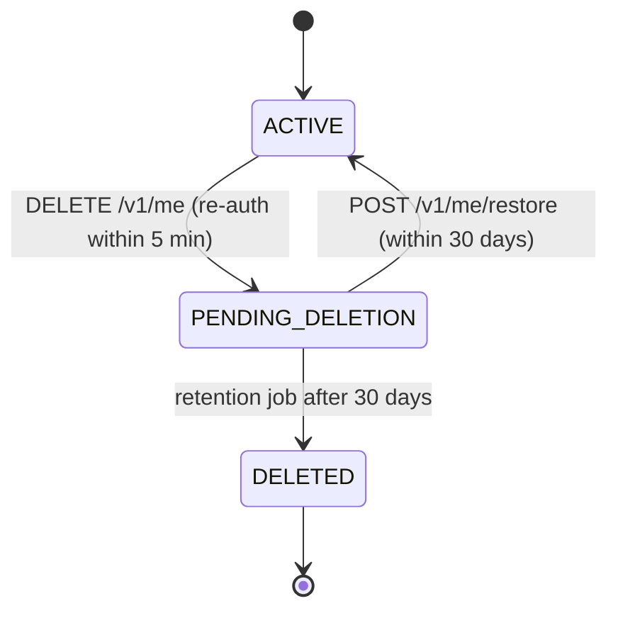

# Users, Profile, Consent and Privacy — Low-Level Design

Service: **profile-service** · see the [service catalog](../../architecture/service-catalog.md) for owned data, events and allowed calls.

## 1. Responsibilities

Profile and preferences, units, consents, roles, and the orchestration of data export and account deletion across all services. Devices and notification preferences belong to notification-service.

## 2. Key rules

- `PATCH /v1/me/profile` validates ranges (height 100–250 cm, weight 25–350 kg, age ≥ 18). Changes to weight, activity, goal, equipment, training days or conditions emit `ProfileChanged{fields}`; workouts and nutrition respond with **proposals** (not silent re-plans).
- Consents are append-only rows; `GET /v1/me/consents` returns the latest per purpose; withdrawing `AI_COACH` closes open conversations for new messages and stops summary jobs.
- Weight changes go through `progress` (BodyMeasurement) — profile holds only height and static attributes.

## 3. Export

`POST /v1/me/exports` → `DataRequest(kind=export)` → `ExportRequested` event → every service writes its part to `user-private/exports/{requestId}/{service}.json` and emits `ExportPartReady` → when all 6 parts are present, profile-service adds its own data and zips JSON (machine-readable) + CSVs → S3 private, SSE-KMS → pre-signed URL (15 min) emailed and shown in app; artefact deleted after 7 days. Idempotent per day (one running export per user).

## 4. Deletion

Hard delete: profile-service emits `AccountDeleted`; every service deletes its rows for that user (coach nulls `UsageRecord.userId`, audit keeps the pseudonymous id) and emits `UserDataPurged`; profile-service then runs Cognito `AdminDeleteUser`, purges the S3 prefix, cascades its own tables, and alerts if any service has not acknowledged within 24 h. `AccountDeletionRequested` makes notification-service stop sending immediately.

## 5. API

`GET /v1/me`, `PATCH /v1/me/profile`, `GET/PATCH /v1/me/preferences`, `GET/POST /v1/me/consents`, `POST /v1/me/exports`, `GET /v1/me/exports/{id}`, `DELETE /v1/me`, `POST /v1/me/restore`. Internal: `GET /internal/v1/users/{id}/context` (age band, units, timezone, tone for coach-service).

## 6. Tests

Each service's export handler covers every one of its tables with `userId` (test enumerates its Prisma models); each service's deletion handler leaves no rows (same enumeration); an end-to-end test in staging deletes a seeded user and checks all databases; restore within grace; consent withdrawal blocks coach.
