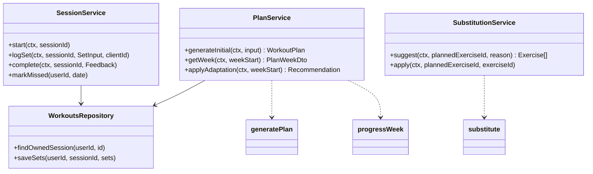

# Workouts — Low-Level Design

Service: **workout-service** · see the [service catalog](../../architecture/service-catalog.md) for owned data, events and allowed calls.

## 1. Responsibilities

Exercise library (read side), templates, plan generation, weekly adaptation, session logging, substitutions, PRs. Engines are pure functions in `packages/domain/src/workouts` (`@aura/domain/workouts`); workout-service wraps them with persistence, authz and events. It keeps `UserTrainingProfile` (from `ProfileChanged` / `OnboardingCompleted`) and `RecoverySignal` (from `CheckInSaved`) so plan generation and adaptation never call another service.

## 2. Structure

```text
services/workout-service/src/
  app.module.ts  main.http.ts  main.worker.ts
  content/ exercises.controller.ts admin-content.controller.ts admin-content.service.ts
           content-store.ts publish-checks.ts engine-mapping.ts library.service.ts library-cache.ts
           policy.ts importer.ts import.cli.ts content-published.subscription.ts
  controllers/ plans.controller.ts sessions.controller.ts
  application/ plan.service.ts session.service.ts substitution.service.ts library.service.ts
  infrastructure/ workouts.repository.ts exercise-cache.ts
  events/ publishers (WorkoutCompleted, PlanWeekReady…) consumers (ProfileChanged, OnboardingCompleted, CheckInSaved…)
  internal/ plans.internal.controller.ts proposals.internal.controller.ts users.internal.controller.ts
packages/domain/src/workouts/
  generate-plan.ts progress-week.ts substitute.ts validate-plan.ts metrics.ts reschedule.ts
  policy.ts eligibility.ts load.ts types.ts
```



## 3. Plan generation algorithm (`generatePlan`)

Input: goal, experience, daysPerWeek (2–6), sessionMinutes, location, equipment set, conditions (codes + severity), intensityCap, preferredDays.

1. **Template selection** — published templates filtered by `goal`, `experience`, `daysPerWeek`, `location`; fallback order: same goal any location → general fitness. Split defaults: 2–3 days full body, 4 days upper/lower, 5–6 days PPL or upper/lower + conditioning (advanced only).
2. **Exercise resolution** — each template slot specifies movement pattern + primary muscle. Candidate exercises: published, equipment ⊆ user's equipment ∪ bodyweight, difficulty ≤ experience, no contraindication mapped from active conditions (see table). Pick the template's default if valid, otherwise the highest-ranked candidate (rank: same pattern, same primary muscle, compound preferred, user's past completion rate).
3. **Volume** — weekly hard sets per major muscle: beginner 8–10, intermediate 10–14, advanced 12–18; fat loss and general fitness at the lower bound; scaled to fit `sessionMinutes` (≈ 2.5 min per set incl. rest + 8 min warm-up).
4. **Intensity** — rep ranges by goal: strength compounds 3–6, hypertrophy 8–12, endurance 12–20; target RPE 7–8 (beginner 6–7). `intensityCap = LOW` → RPE ≤ 6, no 1–5 rep work, no plyometrics.
5. **Starting loads** — none for barbell/machine (user enters first session, engine uses it); dumbbell suggestions from bodyweight ratio table only as a hint labelled "start light".
6. **Schedule** — sessions placed on `trainingDays`, avoiding same-muscle consecutive days for full body.
7. **Validate** (`validatePlan`) — rules below; failure → fall back to a safe default template and log `plan_validation_fallback`.

Contraindication mapping (excerpt, maintained in `CoachingPolicy` `contraindication_map`):

| Condition code | Excluded exercise tags |
|---|---|
| injury_knee (moderate+) | knee_high_load, plyometric, deep_knee_flexion_loaded |
| injury_lower_back | spinal_flexion_loaded, axial_load_heavy |
| injury_shoulder | overhead_loaded, behind_neck |
| pregnancy | supine_after_t1, high_impact, valsalva_heavy, contact |
| hypertension | valsalva_heavy, isometric_max |

Validation rules: weekly sets per muscle within bounds; no session longer than `sessionMinutes + 10`; no excluded tags; RPE ≤ cap; every exercise's equipment available; no more than 2 sessions/week of the same heavy hinge pattern for beginners.

## 4. Weekly adaptation (`progressWeek`)

Runs Sunday 04:00 user-local (worker) or on demand.

Inputs per exercise: prescribed sets × rep range × load × target RPE; logged sets; session status; soreness, sleep, energy check-ins; missed count.

Rules, in order:

1. **Pain** — any `painReported` on an exercise → replace with regression next week and create a `Recommendation` suggesting professional advice if reported twice in 14 days.
2. **Deload** — trigger if (avg session RPE ≥ 9 **and** avg soreness ≥ 4 for 2 consecutive weeks) **or** every 6th week for intermediate/advanced. Deload = sets × 0.5–0.6 (rounded), load unchanged, RPE −2.
3. **Double progression** (per exercise) — if all prescribed sets hit `repMax` at RPE ≤ target: load += increment (barbell 2.5 kg, dumbbell = user's `incrementKg` or 2 kg, machine 5 kg), reps reset to `repMin`. If increment impossible (max dumbbell reached): add 1 set (up to +2) or progress to `Exercise.progression`.
4. **Hold** — sets completed within range: same load, target +1 rep.
5. **Regress** — < 50% of prescribed reps or RPE ≥ 9.5 on first set: load −10% (rounded to increment).
6. **Missed sessions** — missed sessions are not carried as extra volume. If ≥ 2 missed in a week: next week keeps the same prescriptions (no progression) and the engine proposes reducing `daysPerWeek` by one if this happens 3 weeks in a row (as a `Recommendation`, user decides).
7. **Recovery modifiers** — avg sleep < 6 h or energy ≤ 2 for the week → no load increases next week.

Output: new `WorkoutPlanWeek` with sessions and `rationale` codes (e.g. `PROGRESS_LOAD`, `DELOAD_FATIGUE`, `HOLD_MISSED`) that the UI and coach render as explanations.

Estimated 1RM: Epley `w × (1 + reps/30)` for reps ≤ 10, otherwise not computed.

## 5. Substitution (`substitute`)

Candidates share `movementPattern` and at least one primary muscle; equipment ⊆ available (or the requested reason's constraint, e.g. "machine busy" excludes that equipment); excluded tags respected; difficulty within ±1 level. Ranked by muscle overlap (Jaccard) then mechanics match. Returns top 5. Applying sets `PlannedExercise.substitutedFromId` and converts load by a per-pair ratio if defined, else null load.

## 6. Session logging

- Offline-first: client generates `clientId` UUIDs for sets/sessions; `PUT /workout-sessions/{id}/sets` is an idempotent batch upsert keyed by `(sessionId, clientId)`.
- Conflicts: server wins on `status` once `COMPLETED`; later sets are accepted if `completedAt` ≤ session completion + 2 h, else rejected with `409 SESSION_CLOSED`.
- `complete` computes status (`COMPLETED` if ≥ 80% prescribed sets logged, else `PARTIAL`), PRs, and emits `WorkoutCompleted` via outbox.
- Missed: worker marks `PLANNED` sessions with `scheduledDate` < today − 1 as `MISSED` nightly.

## 7. API (summary — full contract in [openapi.yaml](../../api/openapi.yaml))

| Method | Path | Notes |
|---|---|---|
| GET | /v1/exercises | `q`, `muscle`, `equipment`, `pattern`, cursor pagination; public cache |
| GET | /v1/exercises/{slug} | ETag |
| GET | /v1/workout-plans/current | Active plan + current week |
| GET | /v1/workout-plans/current/weeks/{weekStart} | |
| POST | /v1/workout-plans/regenerate | After goal/equipment changes; returns `Recommendation` (proposal) |
| GET | /v1/workout-sessions | `from`, `to`, `status` |
| GET | /v1/workout-sessions/{id} | Owner only |
| POST | /v1/workout-sessions/{id}/start | |
| PUT | /v1/workout-sessions/{id}/sets | Batch idempotent upsert |
| POST | /v1/workout-sessions/{id}/complete | Feedback body |
| POST | /v1/workout-sessions/{id}/exercises/{plannedExerciseId}/substitutions | Suggest |
| PUT | /v1/workout-sessions/{id}/exercises/{plannedExerciseId} | Apply substitution |
| GET | /v1/progress/strength | e1RM series, PRs (served by progress-service from `WorkoutCompleted` data) |
| POST | /internal/v1/plans | Onboarding: create plan (idempotent on onboardingId) |
| GET | /internal/v1/users/{id}/week | Current week for coach tools and dashboard |
| POST | /internal/v1/proposals/validate · /apply | Coach proposals: validate change set, apply with basisVersion |

Errors: `404 NOT_FOUND` (also for others' resources), `409 SESSION_CLOSED`, `422 VALIDATION_FAILED` with field paths.

## 8. Caching

Exercise library list and detail: Redis 1 h + `ETag` (`Cache-Control: private, no-cache`; a matching `If-None-Match` gets 304). Keys carry a generation number; publishing or archiving an exercise bumps it in the http service, and the worker bumps it on `ContentPublished(exercise)` so other instances and imports catch up. A Redis failure falls through to the database. Current plan week: Redis 5 min per user, invalidated on session change or adaptation.

## 9. Engine contract and codes

The engines take plain data (exercise and template rows mapped by the service, a `WorkoutPolicy` loaded from the policy rows) and return plain data. They never read the clock, the network or the database, so results are reproducible and the onboarding saga can retry. Loads are computed in hundredths of a kilogram and rounded to the equipment increment.

Implementation notes on the rules above:

- Training days are the profile's 0–6 day indexes; n and n+1, and 6 and 0, are consecutive. Sessions are placed to minimise shared primary muscles on consecutive days; when that is impossible (e.g. full body on Mon/Tue) the week carries `SCHEDULE_BACK_TO_BACK`.
- Volume is fitted down, never up: each session gets ⌊(`sessionMinutes` − 8) / 2.5⌋ sets, then weekly sets per primary muscle are capped at the experience minimum (fat loss, general fitness) or maximum (other goals). The upper bound is a validation rule; the lower bound is a target, because short sessions cannot always reach it.
- Rep ranges: strength 3–6 on compounds and 8–12 on isolation, muscle gain 8–12, endurance 12–20; fat loss and general fitness keep the template's range. Target RPE is clamped to 6–7 (beginner) or 7–8.
- If the selected template's week fails validation, the engine rebuilds from the policy's safe default template (`safe-default-full-body`), returns `fallback: true` and the rejected issues, and the service logs `plan_validation_fallback`. With no matching template the safe default is used directly.
- Deload keeps 55% of the week's sets (largest-remainder split across exercises, so a 9-set week keeps 5), load unchanged, RPE −2. The week after a deload resumes the last normal week's prescriptions.
- Rule 6 inside a week: `rescheduleMissed` moves only the highest-priority missed session (most compound sets) to the first free day offered by the caller; the others are dropped, never stacked.
- PRs: `e1rm`, `max_load`, `max_reps` per set and `max_volume` (Σ load × reps) per session must beat the previous best strictly.

**Rationale codes** (`RationaleCode`, stored in `WorkoutPlanWeek.rationale` as `{ code, exerciseId?, dayOfWeek?, detail? }`):

| Code | Emitted by | Meaning |
|---|---|---|
| `TEMPLATE_SELECTED` | generatePlan | Template matched goal, experience, days and location |
| `TEMPLATE_FALLBACK_LOCATION` | generatePlan | Same goal, other location |
| `TEMPLATE_FALLBACK_GENERAL` | generatePlan | General fitness template (or the safe default) used |
| `PLAN_VALIDATION_FALLBACK` | generatePlan | Selected template's week failed validation; safe default used |
| `EXERCISE_RESOLVED` | generatePlan | Template exercise replaced (equipment, difficulty, contraindication, duplicate, hinge limit) |
| `SLOT_DROPPED` | generatePlan | No eligible exercise for a slot |
| `VOLUME_FITTED_TO_TIME` | generatePlan | Sets cut to fit `sessionMinutes` |
| `VOLUME_CAPPED` | generatePlan | Weekly sets for a muscle capped |
| `INTENSITY_CAP_LOW` | generatePlan | RPE ≤ 6, no 1–5 rep work, no plyometrics |
| `HINGE_FREQUENCY_LIMITED` | generatePlan | Beginner heavy hinge replaced after 2 sessions |
| `SCHEDULE_BACK_TO_BACK` | generatePlan | Same muscles on consecutive days could not be avoided |
| `START_LIGHT` | generatePlan | Dumbbell load hint shown, labelled "start light" |
| `PROGRESS_LOAD` | progressWeek | Load + increment, reps back to `repMin` |
| `PROGRESS_ADD_SET` | progressWeek | Load cannot rise; one set added (max +2) |
| `PROGRESS_EXERCISE` | progressWeek | Moved to `Exercise.progression` |
| `HOLD_REPS` | progressWeek | Same load, target +1 rep |
| `HOLD_INCOMPLETE` | progressWeek | Not every set done; same load |
| `HOLD_NOT_PERFORMED` | progressWeek | Exercise not logged |
| `HOLD_MAX_REACHED` | progressWeek | No load, set or progression available |
| `HOLD_MISSED` | progressWeek | ≥ 2 missed sessions; prescriptions unchanged |
| `HOLD_RECOVERY` | progressWeek | Sleep < 6 h or energy ≤ 2; no increases |
| `REGRESS_LOAD` | progressWeek | < 50% of reps or first set RPE ≥ 9.5; load −10% |
| `PAIN_REGRESSION` | progressWeek | Pain reported; swapped to the regression |
| `PAIN_LOAD_REDUCED` | progressWeek | Pain reported, no usable regression; load −10% |
| `DELOAD_FATIGUE` | progressWeek | Fatigue two weeks running |
| `DELOAD_SCHEDULED` | progressWeek | Every 6th week (intermediate, advanced) |
| `RESUME_AFTER_DELOAD` | progressWeek | Back to the last normal week |
| `MISSED_RESCHEDULED` | rescheduleMissed | Missed session moved to a free day |

**Recommendations** (proposals the user accepts or declines): `PROFESSIONAL_ADVICE` (second pain report in 14 days), `REDUCE_TRAINING_DAYS` (≥ 2 missed sessions three weeks running, never below 2 days).

**Validation rules** (`validatePlan` issues): `UNKNOWN_EXERCISE`, `EXERCISE_NOT_PUBLISHED`, `EQUIPMENT_UNAVAILABLE`, `DIFFICULTY_ABOVE_EXPERIENCE`, `CONTRAINDICATED_EXERCISE`, `INVALID_PRESCRIPTION`, `RPE_ABOVE_CAP`, `LOW_CAP_HEAVY_REPS`, `INVALID_DAY`, `SESSIONS_SAME_DAY`, `SESSION_TOO_LONG`, `WEEKLY_VOLUME_ABOVE_MAX`, `BEGINNER_HINGE_FREQUENCY`.

## 9a. Content library (TAC-13)

Exercises and templates are versioned in `ContentRevision` (kind, slug, version, status, JSON body as in `exerciseContentSchema` / `templateContentSchema` in `@aura/contracts`). The live library is `Exercise` / `WorkoutTemplate`, one row per slug written on publish; its id stays the same across versions, so plans and logs keep pointing at it. Workflow and checks: [admin LLD §2](../admin/LLD.md#2-content-workflow).

- **Vocabularies.** Equipment, muscle, movement pattern and contraindication codes are `EQUIPMENT_CODES`, `MUSCLE_CODES`, `MOVEMENT_PATTERNS`, `CONTRAINDICATION_TAGS` in contracts; the migration seeds `Equipment` and `MuscleGroup` from them (a test keeps them equal). `bodyweight` alone means no equipment; an exercise counts as bodyweight when it needs no load equipment (a bench, bar or box is not load).
- **Tracking.** `tracking: time` exercises (planks, carries, cardio) prescribe seconds in `repMin`/`repMax`. The engine's goal rep ranges (§9) apply to them too, so strength, muscle-gain and endurance templates avoid time-tracked slots; teaching the engine to keep template ranges for timed exercises is a TAC-18 follow-up.
- **Policy.** `WorkoutPolicy` holds one row per `WorkoutPolicy` field, seeded from `DEFAULT_WORKOUT_POLICY`; `loadWorkoutPolicy` falls back to the default for any missing field.
- **Starter dataset.** `content/workouts/` holds 120 exercises (one file per movement pattern) and 13 templates (full body 2–3 days, upper/lower 4 days, push/pull/legs 5–6 days across all goals, gym and home, plus `safe-default-full-body`), all `IN_REVIEW` with `reviewRequired: trainer` until a qualified trainer signs off (TAC-44). Media is empty; `illustrationKey` names a placeholder per pattern.
- **Import.** `pnpm content:import [--dry-run] [--publish]` (needs `DATABASE_URL`) validates every file, then upserts by slug through the same store as the admin API (audited as `content_import`): new slugs are created, open versions are edited, published ones get a new version, unchanged ones are skipped, so a second run does nothing. `--publish` (refused when `NODE_ENV=production`) publishes every open version, exercises first; it is the local/dev seed.

## 10. Tests

- Unit (domain): table-driven tests for every progression rule, deload triggers, contraindication filtering, substitution ranking, time budgeting; property tests (fast-check) that generated plans always pass `validatePlan` for random valid inputs.
- Integration: generate → log → complete → adapt cycle on Testcontainers Postgres; idempotent set upsert; cross-user 404.
- Content: `content-dataset.test.ts` (schema, coverage, publish checks for every item, plans for every goal × location × days, seed migration = contracts and policy defaults); `content.int.test.ts` (workflow and permissions, immutable versions, ContentPublished and audit once per publish, template refusal by synthetic profile, importer idempotency, library filters, ETag 304 and invalidation).
- BDD: scenarios in [acceptance-criteria.md](../../requirements/acceptance-criteria.md#workouts).
