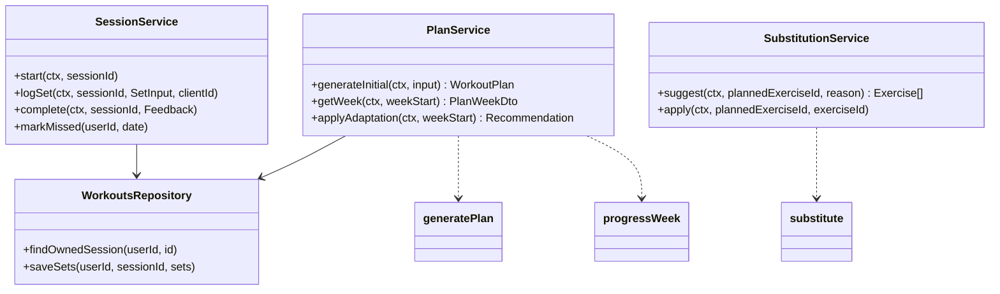

# Workouts — Low-Level Design

Service: **workout-service** · see the [service catalog](../../architecture/service-catalog.md) for owned data, events and allowed calls.

## 1. Responsibilities

Exercise library (read side), templates, plan generation, weekly adaptation, session logging, substitutions, PRs. Engines are pure functions in `packages/domain/workouts`; workout-service wraps them with persistence, authz and events. It keeps `UserTrainingProfile` (from `ProfileChanged` / `OnboardingCompleted`) and `RecoverySignal` (from `CheckInSaved`) so plan generation and adaptation never call another service.

## 2. Structure

```text
services/workout-service/src/
  app.module.ts  main.http.ts  main.worker.ts
  controllers/ exercises.controller.ts plans.controller.ts sessions.controller.ts
  application/ plan.service.ts session.service.ts substitution.service.ts library.service.ts
  infrastructure/ workouts.repository.ts exercise-cache.ts
  events/ publishers (WorkoutCompleted, PlanWeekReady…) consumers (ProfileChanged, OnboardingCompleted, CheckInSaved…)
  internal/ plans.internal.controller.ts proposals.internal.controller.ts users.internal.controller.ts
packages/domain/workouts/
  generate-plan.ts progress-week.ts substitute.ts validate-plan.ts e1rm.ts types.ts
```



## 3. Plan generation algorithm (`generatePlan`)

Input: goal, experience, daysPerWeek (2–6), sessionMinutes, location, equipment set, conditions (codes + severity), intensityCap, preferredDays.

1. **Template selection** — published templates filtered by `goal`, `experience`, `daysPerWeek`, `location`; fallback order: same goal any location → general fitness. Split defaults: 2–3 days full body, 4 days upper/lower, 5–6 days PPL or upper/lower + conditioning (advanced only).
2. **Exercise resolution** — each template slot specifies movement pattern + primary muscle. Candidate exercises: published, equipment ⊆ user's equipment ∪ bodyweight, difficulty ≤ experience, no contraindication mapped from active conditions (see table). Pick the template's default if valid, otherwise the highest-ranked candidate (rank: same pattern, same primary muscle, compound preferred, user's past completion rate).
3. **Volume** — weekly hard sets per major muscle: beginner 8–10, intermediate 10–14, advanced 12–18; fat loss and general fitness at the lower bound; scaled to fit `sessionMinutes` (≈ 2.5 min per set incl. rest + 8 min warm-up).
4. **Intensity** — rep ranges by goal: strength compounds 3–6, hypertrophy 8–12, endurance 12–20; target RPE 7–8 (beginner 6–7). `intensityCap = LOW` → RPE ≤ 6, no 1–5 rep work, no plyometrics.
5. **Starting loads** — none for barbell/machine (user enters first session, engine uses it); dumbbell suggestions from bodyweight ratio table only as a hint labelled "start light".
6. **Schedule** — sessions placed on `trainingDays`, avoiding same-muscle consecutive days for full body.
7. **Validate** (`validatePlan`) — rules below; failure → fall back to a safe default template and log `plan_validation_fallback`.

Contraindication mapping (excerpt, maintained in `CoachingPolicy` `contraindication_map`):

| Condition code | Excluded exercise tags |
|---|---|
| injury_knee (moderate+) | knee_high_load, plyometric, deep_knee_flexion_loaded |
| injury_lower_back | spinal_flexion_loaded, axial_load_heavy |
| injury_shoulder | overhead_loaded, behind_neck |
| pregnancy | supine_after_t1, high_impact, valsalva_heavy, contact |
| hypertension | valsalva_heavy, isometric_max |

Validation rules: weekly sets per muscle within bounds; no session longer than `sessionMinutes + 10`; no excluded tags; RPE ≤ cap; every exercise's equipment available; no more than 2 sessions/week of the same heavy hinge pattern for beginners.

## 4. Weekly adaptation (`progressWeek`)

Runs Sunday 04:00 user-local (worker) or on demand.

Inputs per exercise: prescribed sets × rep range × load × target RPE; logged sets; session status; soreness, sleep, energy check-ins; missed count.

Rules, in order:

1. **Pain** — any `painReported` on an exercise → replace with regression next week and create a `Recommendation` suggesting professional advice if reported twice in 14 days.
2. **Deload** — trigger if (avg session RPE ≥ 9 **and** avg soreness ≥ 4 for 2 consecutive weeks) **or** every 6th week for intermediate/advanced. Deload = sets × 0.5–0.6 (rounded), load unchanged, RPE −2.
3. **Double progression** (per exercise) — if all prescribed sets hit `repMax` at RPE ≤ target: load += increment (barbell 2.5 kg, dumbbell = user's `incrementKg` or 2 kg, machine 5 kg), reps reset to `repMin`. If increment impossible (max dumbbell reached): add 1 set (up to +2) or progress to `Exercise.progression`.
4. **Hold** — sets completed within range: same load, target +1 rep.
5. **Regress** — < 50% of prescribed reps or RPE ≥ 9.5 on first set: load −10% (rounded to increment).
6. **Missed sessions** — missed sessions are not carried as extra volume. If ≥ 2 missed in a week: next week keeps the same prescriptions (no progression) and the engine proposes reducing `daysPerWeek` by one if this happens 3 weeks in a row (as a `Recommendation`, user decides).
7. **Recovery modifiers** — avg sleep < 6 h or energy ≤ 2 for the week → no load increases next week.

Output: new `WorkoutPlanWeek` with sessions and `rationale` codes (e.g. `PROGRESS_LOAD`, `DELOAD_FATIGUE`, `HOLD_MISSED`) that the UI and coach render as explanations.

Estimated 1RM: Epley `w × (1 + reps/30)` for reps ≤ 10, otherwise not computed.

## 5. Substitution (`substitute`)

Candidates share `movementPattern` and at least one primary muscle; equipment ⊆ available (or the requested reason's constraint, e.g. "machine busy" excludes that equipment); excluded tags respected; difficulty within ±1 level. Ranked by muscle overlap (Jaccard) then mechanics match. Returns top 5. Applying sets `PlannedExercise.substitutedFromId` and converts load by a per-pair ratio if defined, else null load.

## 6. Session logging

- Offline-first: client generates `clientId` UUIDs for sets/sessions; `PUT /workout-sessions/{id}/sets` is an idempotent batch upsert keyed by `(sessionId, clientId)`.
- Conflicts: server wins on `status` once `COMPLETED`; later sets are accepted if `completedAt` ≤ session completion + 2 h, else rejected with `409 SESSION_CLOSED`.
- `complete` computes status (`COMPLETED` if ≥ 80% prescribed sets logged, else `PARTIAL`), PRs, and emits `WorkoutCompleted` via outbox.
- Missed: worker marks `PLANNED` sessions with `scheduledDate` < today − 1 as `MISSED` nightly.

## 7. API (summary — full contract in [openapi.yaml](../../api/openapi.yaml))

| Method | Path | Notes |
|---|---|---|
| GET | /v1/exercises | `q`, `muscle`, `equipment`, `pattern`, cursor pagination; public cache |
| GET | /v1/exercises/{slug} | ETag |
| GET | /v1/workout-plans/current | Active plan + current week |
| GET | /v1/workout-plans/current/weeks/{weekStart} | |
| POST | /v1/workout-plans/regenerate | After goal/equipment changes; returns `Recommendation` (proposal) |
| GET | /v1/workout-sessions | `from`, `to`, `status` |
| GET | /v1/workout-sessions/{id} | Owner only |
| POST | /v1/workout-sessions/{id}/start | |
| PUT | /v1/workout-sessions/{id}/sets | Batch idempotent upsert |
| POST | /v1/workout-sessions/{id}/complete | Feedback body |
| POST | /v1/workout-sessions/{id}/exercises/{plannedExerciseId}/substitutions | Suggest |
| PUT | /v1/workout-sessions/{id}/exercises/{plannedExerciseId} | Apply substitution |
| GET | /v1/progress/strength | e1RM series, PRs (served by progress-service from `WorkoutCompleted` data) |
| POST | /internal/v1/plans | Onboarding: create plan (idempotent on onboardingId) |
| GET | /internal/v1/users/{id}/week | Current week for coach tools and dashboard |
| POST | /internal/v1/proposals/validate · /apply | Coach proposals: validate change set, apply with basisVersion |

Errors: `404 NOT_FOUND` (also for others' resources), `409 SESSION_CLOSED`, `422 VALIDATION_FAILED` with field paths.

## 8. Caching

Exercise library list and detail: Redis 1 h + `ETag`, invalidated by `ContentPublished(exercise)`. Current plan week: Redis 5 min per user, invalidated on session change or adaptation.

## 9. Tests

- Unit (domain): table-driven tests for every progression rule, deload triggers, contraindication filtering, substitution ranking, time budgeting; property tests (fast-check) that generated plans always pass `validatePlan` for random valid inputs.
- Integration: generate → log → complete → adapt cycle on Testcontainers Postgres; idempotent set upsert; cross-user 404.
- BDD: scenarios in [acceptance-criteria.md](../../requirements/acceptance-criteria.md#workouts).
