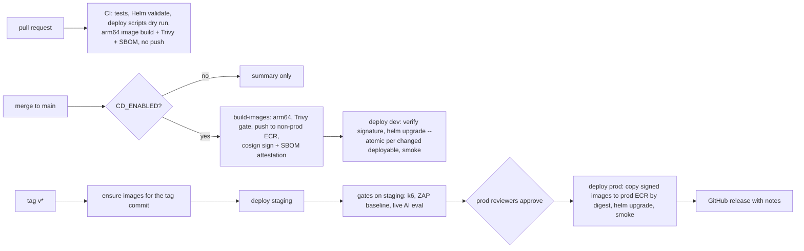

# Deployment

How AuraCoach would be deployed to the Stage 1 k3s nodes ([ADR-007](../architecture/ADR/ADR-007-hosting.md)) with the Helm charts in `infra/helm` ([TAC-35](https://harisireddi7776.atlassian.net/browse/TAC-35)). **Nothing here has been run against a cluster.** The CD workflows ([TAC-37](https://harisireddi7776.atlassian.net/browse/TAC-37), [ADR-010](../architecture/ADR/ADR-010-cd-helm-cli.md)) are written and checked in CI but stay off until the owner creates the AWS accounts and sets `CD_ENABLED` (§5, [TAC-44](https://harisireddi7776.atlassian.net/browse/TAC-44)). CI only lints, renders and validates.

Layout and network design: [deployment architecture](../architecture/deployment-architecture.md). Who may call whom: [service catalog §4](../architecture/service-catalog.md#4-allowed-synchronous-dependencies).

## 1. What gets installed, in order

| # | Release | Chart | Namespace | Per |
|---|---|---|---|---|
| 1 | Traefik config | k3s bundled Traefik, configured by `infra/k3s/traefik-config.yaml` (placed by cloud-init) | `kube-system` | cluster |
| 2 | `cert-manager`, `external-secrets` | upstream charts, pinned in `infra/k3s/addons.yaml`, values in `infra/k3s/values/` | `aura-system` | cluster |
| 3 | `platform` | `infra/helm/aura-platform` with `values-nonprod.yaml` or `values-prod.yaml` | `aura-system` | cluster |
| 3b | `otel-collector` | upstream chart from `addons.yaml` (`afterPlatform`: it reads the Grafana Cloud Secret the platform syncs) | `aura-system` | cluster |
| 4 | `datastores-<env>` | `infra/helm/aura-datastores` (dev and staging only) | `<env>-aura-data` | non-prod environment |
| 5 | `<deployable>` | `infra/helm/aura-service` | `[<env>-]aura-services` or `[<env>-]aura-edge` | deployable × environment |

Rows 1–4 are installed by the *Cluster platform* workflow (§5), row 5 by the deploy workflows.

`aura-platform` creates each environment's namespaces with the **restricted** Pod Security Standard, a default-deny NetworkPolicy plus a DNS allowance in each, a `SecretStore` per namespace, the origin certificate for Traefik and the Let's Encrypt `ClusterIssuer`. Prod has `aura-edge` and `aura-services`; the non-prod node has `dev-` and `staging-` copies of those plus `<env>-aura-data`.

The nine deployables are `api-gateway`, `web` and the seven NestJS services. Each NestJS service release has:

| Object | Notes |
|---|---|
| `<name>-http` Deployment, Service, PDB (2+ replicas) | Probes: startup and liveness on `/health/live`, readiness on `/health/ready` (database, Redis). Rolling update with `maxUnavailable: 0` |
| `<name>-worker` Deployment | `node dist/main.worker.js`: outbox relay, stream consumers, jobs. No HTTP server, so no probes; a crash exits and restarts the pod |
| `<name>-migrate` Job (pre-install and pre-upgrade hook) | `prisma migrate deploy` with the migration user. Brings its own ServiceAccount, NetworkPolicy (Postgres only) and ExternalSecret as earlier hooks, because hooks run before the release's normal objects exist |
| ConfigMap `<name>-env`, ExternalSecret `<name>-env` | Environment for both deployments (§3) |
| NetworkPolicies `<name>-ingress`, `<name>-egress` | Generated from the call graph (§4) |
| ServiceAccount | No API token mounted; Stage 2 adds the IRSA annotation |

Every container runs as non-root with a read-only root filesystem, no capabilities, no privilege escalation and the `RuntimeDefault` seccomp profile; `/tmp` (and for nginx and Next.js their cache paths) are `emptyDir` volumes.

## 2. Values

A release is rendered from these files, later ones winning:

1. `infra/helm/aura-service/values.yaml`: chart defaults, documented inline.
2. `infra/helm/values/common.yaml`: the deployables, their namespaces and ports, and `global.callGraph`.
3. `infra/helm/values/env/<env>.yaml`: replicas, sizing, Secrets Manager prefix, where Postgres and Redis are.
4. `infra/helm/values/<deployable>.yaml`: kind, image, secrets it reads, internet and AWS access, ingress.
5. `infra/helm/values/stage/eks.yaml`: Stage 2 only (ALB ingress, HPA on, zone spread, no metadata access).
6. Deploy inputs from Terraform (below).

No values file contains a secret; CI fails if one does (§6).

### Deploy inputs

The deploy job reads these from the account's Terraform outputs on every run (`tools/deploy/deploy-inputs.mjs`). `infra/helm/ci/*.yaml` holds fake examples used only to render in CI.

| Input | Chart | Source |
|---|---|---|
| `image.tag` | aura-service | Git SHA the CD workflow built and pushed |
| `global.imageRegistry` | aura-service | ECR registry of the account |
| `global.auth.issuer`, `global.auth.jwksUrl`, `global.auth.clientIds`, `global.auth.userPoolId` | aura-service | Cognito user pool and app clients (the pool id only for profile-service, which mirrors role grants to Cognito groups) |
| `global.objectStorage.bucket`, `global.objectStorage.kmsKeyId` (optional) | aura-service | Storage module `bucket_names.user_private`, where every node service writes its part of a data export; the key defaults to the bucket's SSE-KMS key |
| `web.appUrl`, `web.oidcDomainUrl`, `web.oidcClientId` | aura-service (web) | Public domain, Cognito hosted UI domain, web app client |
| `ingress.host` | aura-service (api-gateway, web) | `origin.<domain>` |
| `ingress.originVerify.value` | aura-service (api-gateway, web) | Secrets Manager, passed with `set_sensitive` |
| `global.datastores.postgres.cidrs`, `global.datastores.redis.cidrs` | aura-service (prod) | Isolated subnet CIDRs of RDS and ElastiCache |
| `environments.<env>.secretsRoleArn`, `environments.<env>.originHost` | aura-platform | IAM role per environment that may read only `auracoach/<env>/*`; origin host |
| `system.secretsRoleArn`, `acme.email`, `acme.hostedZoneId` | aura-platform | Role reading `auracoach/<cluster>/platform`; Let's Encrypt account e-mail; Route 53 zone |

### Sizing (Stage 1)

| | prod (`t4g.xlarge`, 16 GiB) | dev and staging (`t4g.large`, 8 GiB, both on one node) |
|---|---|---|
| NestJS http | 2 replicas, request 100m / 256 Mi, limit 512 Mi | 1 replica, 50m / 160 Mi, limit 384 Mi |
| NestJS worker | 1, request 50m / 192 Mi, limit 384 Mi | 1, 25m / 128 Mi, limit 320 Mi |
| api-gateway | 2, 50m / 32 Mi, limit 128 Mi | 1, same |
| web | 2, 50m / 192 Mi, limit 512 Mi | 1, same |
| Postgres, Redis | RDS, ElastiCache | 50m / 256 Mi and 25m / 64 Mi per environment |
| Total requests | ≈ 5.3 GiB, 1.95 vCPU | ≈ 5.0 GiB, 1.4 vCPU for both environments |

That leaves room in prod for a surge pod per rolling update and the system add-ons. HPA is in the chart but off on k3s; there is nowhere to scale to on one node. Scale up the instance first (ADR-007 triggers).

## 3. Secrets

AWS Secrets Manager, synced by External Secrets into Kubernetes Secrets. Never in Git, values or Terraform state.

| Secrets Manager key | Properties | Read by |
|---|---|---|
| `auracoach/<env>/<service>` | `DATABASE_URL` (app user, DML only), `REDIS_URL` (Redis ACL user), `MIGRATION_DATABASE_URL` (owner user, DDL) | that service; the migration key only by its migration Job |
| `auracoach/<env>/shared` | `INTERNAL_TOKEN_SECRET` | every NestJS service |
| `auracoach/<env>/web` | `SESSION_SECRET`, `OIDC_CLIENT_SECRET` | web |
| `auracoach/<env>/datastores` (non-prod) | `POSTGRES_PASSWORD`, `REDIS_PASSWORD`, `<SERVICE>_DB_PASSWORD` | aura-datastores; in non-prod one role per service owns its database, so both URLs use it |
| `auracoach/<cluster>/platform` | `GRAFANA_CLOUD_OTLP_ENDPOINT`, `GRAFANA_CLOUD_INSTANCE_ID`, `GRAFANA_CLOUD_API_TOKEN` | the OpenTelemetry collector |

Each namespace's `SecretStore` assumes the environment's role, which the node role may assume and which can read only that environment's prefix. On the shared non-prod node, dev therefore cannot read staging's secrets.

## 4. Network policy

Every environment namespace starts as deny-all with DNS allowed. Each release then opens exactly:

- **Ingress** to its http pods from the deployables that call it in `global.callGraph`, and for `api-gateway` and `web` from Traefik.
- **Egress** to its callees, to Postgres and Redis (RDS and ElastiCache CIDRs in prod, the `aura-data` pods in non-prod), to the collector on 4318, and where its values say so, to public addresses on 443 (`internetEgress`) and to the instance metadata endpoint (`awsMetadata`, Stage 1 only). Every node service needs both for S3, since each writes its part of a data export to the user-private bucket.

| Deployable | Internet 443 | Metadata (node role) | Why |
|---|---|---|---|
| profile-service | yes | yes | Cognito admin API |
| workout-service | yes | yes | S3 exercise media |
| nutrition-service | yes | no | Open Food Facts |
| coach-service | yes | no | AI provider |
| notification-service | yes | yes | Expo Push, SES |
| web | yes | no | Cognito token endpoint |
| progress-service, audit-service | yes | yes | AWS AppConfig only (feature flags) |
| api-gateway | no | no | internal only |

Every NestJS service reads feature flags from AWS AppConfig (`global.flags.source: appconfig`, application `auracoach`, environment = `dev`/`staging`/`prod`, profile `flags`; platform LLD §11), so each gets 443 egress and, in Stage 1, the metadata endpoint for the node role. A NetworkPolicy cannot narrow 443 to AppConfig's addresses; the Route 53 DNS Firewall allow-list is what limits the domains.

`global.callGraph` is the single source for the allow-lists, `INTERNAL_SERVICE_URLS` and the gateway's upstreams. CI compares it with the service catalog diagram and checks every rendered policy against it, so a new call needs a catalog (ADR) change first.

## 5. Continuous delivery

GitHub Actions, off until `CD_ENABLED` is `true` ([ADR-010](../architecture/ADR/ADR-010-cd-helm-cli.md)). While off, every workflow below runs only its planning step and writes a summary of what it would have built or deployed; nothing is pushed, signed or deployed, and no AWS role is assumed.



| Workflow | Trigger | What it does |
|---|---|---|
| `build-images.yml` | called | Per deployable on a native arm64 runner: `docker buildx` for `linux/arm64` (Graviton), Trivy gate on fixable critical CVEs **before** any push, CycloneDX SBOM (artifact). With `push`: ECR push with provenance, keyless cosign signature and signed SBOM attestation. Already-pushed tags are skipped (ECR tags are immutable) |
| `ci.yml` (job *Images*) | every PR and push | `build-images.yml` with `push: false`: the release build as a dry run, no secrets. The *Helm charts* job also renders `tools/deploy/helm-deploy.sh` and `install-platform.sh` for every environment with the example inputs and validates the result; *CD workflows and scripts* runs actionlint (with shellcheck) and the script unit tests |
| `release-images.yml` | merge to main, or by hand | Deployables changed by the merge (`tools/ci/affected-services.mjs`, ADR-007) → `build-images.yml` (push, environment `dev`) → `deploy.yml` to dev |
| `deploy.yml` | called, or by hand (redeploy a commit) | In the target GitHub environment: assume `AWS_DEPLOY_ROLE_ARN`, read deploy inputs from `terraform output` (`tools/deploy/deploy-inputs.mjs`), read the origin header from Secrets Manager, fetch the kubeconfig from SSM, open the SSM port forward, verify each image's signature (prod first copies the signed image, signatures and SBOM from the non-prod ECR by digest), `tools/deploy/helm-deploy.sh`, then `tools/smoke/deploy-smoke.sh` |
| `release.yml` | tag `v*` | Deployables changed since the previous `v*` tag (all on the first release) → images → staging → gates → prod (waits for the `prod` environment's required reviewers) → GitHub release with notes from `tools/release/release-notes.mjs` |
| `rollback.yml` | by hand | `helm rollback` of one deployable to the previous (or a given) revision, then smoke |
| `platform.yml` (*Cluster platform*) | by hand | `tools/deploy/install-platform.sh`: cert-manager and external-secrets, `aura-platform`, the OpenTelemetry collector (it reads a Secret the platform syncs), and in non-prod `aura-datastores` for dev and staging |

Jobs that touch one environment share the concurrency group `deploy-<env>`, so a rollback never races a deploy.

### What one deploy runs

`tools/deploy/helm-deploy.sh <env> <sha> <inputs.json> <deployable>...` renders the same values chain as CI (§2) and, for each deployable (services first, then `api-gateway`, then `web`), runs the equivalent of:

```bash
# Prod example. Non-prod: --namespace dev-aura-services and values/env/dev.yaml.
helm upgrade --install profile-service infra/helm/aura-service \
  --namespace aura-services \
  -f infra/helm/values/common.yaml \
  -f infra/helm/values/env/prod.yaml \
  -f infra/helm/values/profile-service.yaml \
  -f service-inputs.json \
  --set-string image.tag="$GIT_SHA" \
  --atomic --wait --timeout 10m --history-max 10
```

`service-inputs.json` holds the deploy inputs of §2 taken from the account's Terraform outputs (registry, Cognito, origin host, and in prod the data-store CIDRs). For `api-gateway` and `web` the origin header value is added from a temporary values file readable only by the job, never as a command-line argument. `DRY_RUN=1` renders with `helm template` instead; CI does that for every environment.

What happens in the cluster:

1. Hooks: the migration ServiceAccount and NetworkPolicy, then its ExternalSecret, then the Job. External Secrets fills the Secret within seconds; until then the Job's pod waits. A failed migration fails the release and nothing else changes.
2. ConfigMap, ExternalSecret, Service and NetworkPolicies are applied; both Deployments roll one pod at a time and wait for readiness.
3. With `--atomic`, a release that does not become ready in time is rolled back to the previous revision. The database is not rolled back, which is why only expand migrations ship with code ([deployment architecture §4](../architecture/deployment-architecture.md#4-cicd-github-actions)).

The smoke test then checks that each release is `deployed` with all Deployments available and, when `SMOKE_APP_URL` and `SMOKE_API_URL` are set for the environment, that `https://app…/api/health` answers 200 and an unauthenticated `https://api…/v1/me` reaches the gateway and is refused with 401.

The non-prod node is stopped out of hours (weekdays 08:00–20:00 IST). A deploy to dev or staging outside those hours fails with a clear error; the pipeline never starts the instance, because that costs money.

Hook objects (the migration ServiceAccount, NetworkPolicy and ExternalSecret) are not part of the release's manifest, so `helm uninstall` leaves them. Delete them with `kubectl delete sa,networkpolicy,externalsecret -l app.kubernetes.io/component=migrate -n <namespace>` after an uninstall.

### Rolling back

- **Code:** run *Rollback* with the environment and deployable (revision empty = the previous one), or re-run *Deploy* with the previous commit. From an operator machine with the port forward of infrastructure.md step 10: `helm rollback <deployable> [revision] -n <namespace> --wait`.
- **Restoring a database** (data damage, not a bad release): in prod, restore RDS to a point in time into a new instance (`aws rds restore-db-instance-to-point-in-time --source-db-instance-identifier <prod db> --target-db-instance-identifier <prod db>-restore --restore-time <UTC time>`, same subnet group, security group and parameter group), check the data, then point the affected service's `DATABASE_URL` and `MIGRATION_DATABASE_URL` in `auracoach/prod/<service>` at the new endpoint and restart that service's pods; keep the old instance until the restore is confirmed. Only the affected service's database needs moving, because each service owns its own. Cross-region copies (weekly, `ap-southeast-1`) cover a lost region ([deployment architecture §6](../architecture/deployment-architecture.md#6-backup-and-disaster-recovery)). In non-prod, data is synthetic: delete the StatefulSet's volume and let migrations recreate the schema.

### Enabling CD (owner checklist)

Everything below is free on GitHub; the AWS steps create billable resources and are the owner's call ([TAC-44](https://harisireddi7776.atlassian.net/browse/TAC-44)).

1. Apply Terraform for both accounts ([infrastructure](infrastructure.md), steps 1–9). Set `prod_account_id` in the non-prod tfvars and `nonprod_account_id` in the prod tfvars (release promotion), and apply both again.
2. GitHub environments: `dev`, `staging` (no reviewers) and `prod` (**required reviewers**: this is the manual approval before prod; also restrict it to tags `v*`). Restrict `dev` to `main`.
3. Environment variables (Settings → Environments, all non-secret):

   | Variable | dev | staging | prod |
   |---|---|---|---|
   | `AWS_DEPLOY_ROLE_ARN` | non-prod `github_roles.deploy` | same | prod `github_roles.deploy` |
   | `SMOKE_APP_URL`, `SMOKE_API_URL` | `https://app.dev.<domain>`, `https://api.dev.<domain>` | `…staging…` | `https://app.<domain>`, `https://api.<domain>` |
   | `NONPROD_ECR_REGISTRY_ID` | — | — | non-prod account ID |

4. Repository variables: `TF_BACKEND_HCL_NONPROD` and `TF_BACKEND_HCL_PROD` (contents of each `backend.hcl`, already needed for `terraform plan`), and `ACME_EMAIL` (Let's Encrypt account e-mail).
5. Set the repository variable `CD_ENABLED=true`, then straight away run *Cluster platform* for `nonprod` and then `prod` (add-ons, `aura-platform`, non-prod data stores). A merge before that would fail its dev deploy, harmlessly.
6. Run *Release images* by hand with deployables `all` to fill dev. From then on each merge to main builds, pushes and deploys what it changed.
7. Releases: push a tag `v<semver>` on main. Until the k6 suite (TAC-40) and the live AI eval (TAC-28) exist, set `RELEASE_ALLOW_MISSING_GATES=true` to release without them; a missing gate otherwise fails the release. The live AI eval calls the AI provider, so each release run costs a little AI spend once it exists.

### Stage 2 (EKS)

Add `-f infra/helm/values/stage/eks.yaml` and the IRSA role as `serviceAccount.annotations."eks\.amazonaws\.com/role-arn"`. The chart then renders an ALB `Ingress` (with a listener condition on `X-Origin-Verify`) instead of a Traefik `IngressRoute`, turns HPA on and spreads replicas over zones. No application change.

## 6. Validation in CI

The `Helm charts` job runs on changes to `infra/helm/`, `infra/k3s/`, the catalog, Dockerfiles or workflows: `tools/ci/helm-validate.sh --addons`.

| Step | What it proves |
|---|---|
| `helm lint --strict` | Charts and values schemas; every deployable × environment |
| `helm template` | 27 Stage 1 releases, 9 Stage 2 releases, both platform variants, both non-prod data stores, and the three add-ons at their pinned versions |
| `kubeconform -strict` (Kubernetes 1.36, k3s `v1.36.5+k3s1`) | Every object against the API schemas, CRDs (ExternalSecret, IngressRoute, Certificate, HelmChartConfig) from the datree CRDs catalog |
| `kube-linter` with `infra/helm/.kube-linter.yaml` | Non-root, read-only root filesystem, resources set, probes, anti-affinity, PDBs, no host access. Exceptions are annotations with a reason |
| `tools/ci/check-network-policies.mjs` | Call graph equals the catalog; rendered policies, `INTERNAL_SERVICE_URLS` and gateway upstreams match it; migration hook and probes everywhere; no secret in any values file |

Run it locally with the same tools on `PATH` (helm 3, kubeconform, kube-linter, yq v4): `tools/ci/helm-validate.sh` (add `--addons` if the chart repositories are reachable).

### k3d smoke (optional)

`tools/smoke/k3d-smoke.sh` builds the profile-service image, creates a throwaway k3d cluster on the pinned k3s version, installs `aura-datastores` and `aura-service` for profile-service with the dev values, and checks that the migration hook, probes, worker, restricted Pod Security and NetworkPolicies work (the gateway label gets through, any other pod does not). It creates Secrets directly instead of installing External Secrets, and deletes the cluster at the end (`KEEP_CLUSTER=1` keeps it). CI runs it as a non-blocking job.

## 7. Known gaps

| Gap | Owner |
|---|---|
| coach-service will need the AI provider key in `auracoach/<env>/coach-service` and in `secrets.keys` | TAC-25 |
| CloudFront forwards the viewer `Host` (origin request policy AllViewer) while the IngressRoutes and origin certificate use `origin.<domain>`, and dev and staging share that one origin host; must be fixed before the first deploy | [TAC-46](https://harisireddi7776.atlassian.net/browse/TAC-46) |
| No staged canary (10% → 50% → 100%): MVP uses Helm `--atomic` plus the smoke gate, as the deployment architecture allows | Stage 2 (Argo Rollouts) |
| Playwright and Maestro E2E on dev after each deploy, k6 load suite, live AI eval | TAC-40, TAC-28 |
| The `X-Origin-Verify` value sits in the IngressRoute object; anyone who can read IngressRoutes in `aura-edge` can read it. Cluster access is limited to the deploy role and operators (SSM) | accepted for beta |
| system-upgrade-controller and OS patching plans | TAC-41 |
