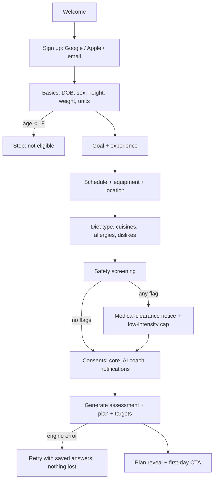
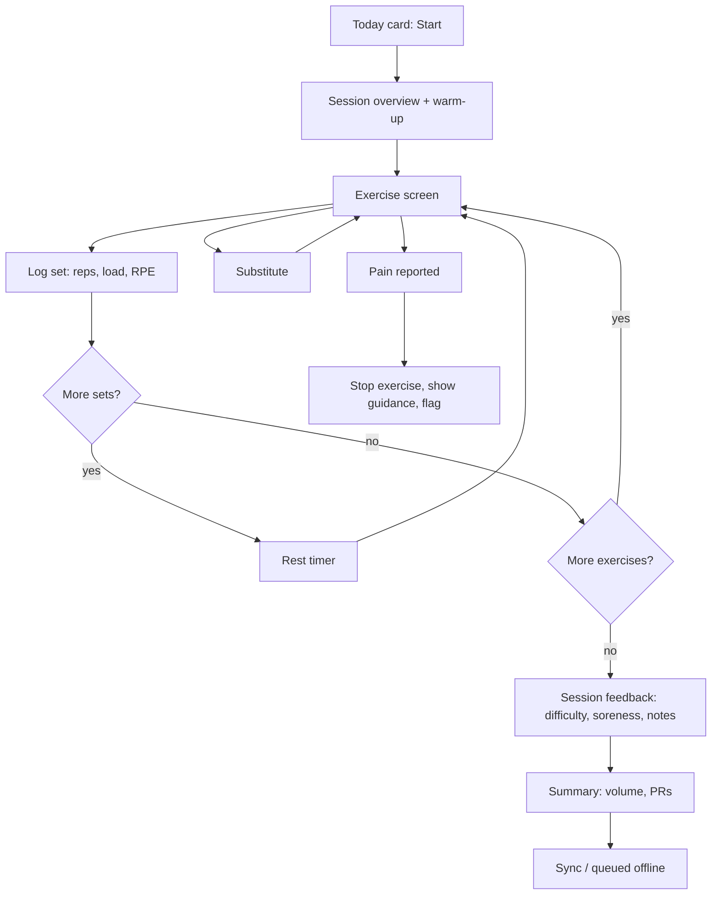
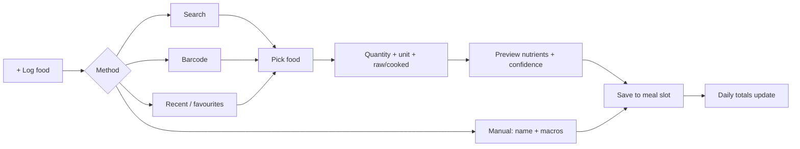
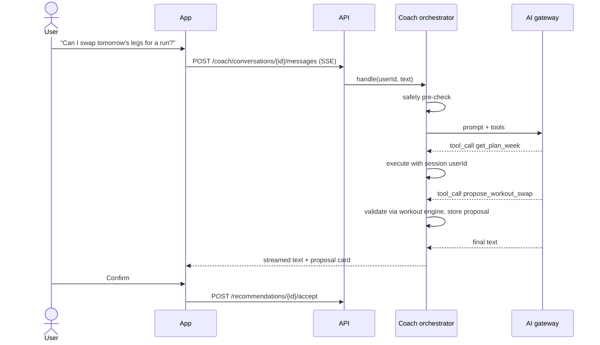

# User Journeys and Flows

## 1. Journey map — Priya's first two weeks

| Stage | Doing | Thinking / feeling | Product response |
|---|---|---|---|
| Discover | Installs from Play Store ad | "Will this know Indian food?" | Welcome shows Indian meals and home workouts |
| Onboard | 6 short steps, ~3 min | Wary of long forms | Progress bar, skip for optional fields, why-we-ask tooltips |
| First plan | Sees assessment and plan | Wants to trust numbers | Plain-language explanation and "ask the coach why" |
| Day 1 | 30-min dumbbell session | Unsure of form | Demo video, cues, rest timer, haptic set done |
| Day 1–3 | Logs meals | Logging fatigue | Recent foods, katori units, "same as yesterday" |
| Day 5 | Misses a session | Guilt | Neutral nudge, plan re-arranged, no streak shaming |
| Week 1 end | Weekly summary | "Is it working?" | Trend range, consistency, one focus for next week |
| Week 2 | Asks coach about protein | Wants practical help | Answer from her targets with veg options; proposes meal swap |

## 2. Core flows

### 2.1 Onboarding

### 2.2 Active workout

### 2.3 Food logging

### 2.4 AI coach

### 2.5 Progress check-in

Weekly prompt on Sunday morning → weigh-in (optional) → measurements (optional) → sleep/energy/soreness → summary with trend band and one adjustment proposal → accept/decline.

## 3. Error and edge journeys

| Situation | Behaviour |
|---|---|
| Offline mid-session | Logs stored locally; banner "Saved on this device, will sync" |
| AI unavailable | Coach shows status and FAQ shortcuts; everything else works |
| Food not found | Offer manual entry and "request this food" for admin review |
| Unrealistic goal (e.g. 10 kg in 2 weeks) | Explain safe rate (0.25–1% bodyweight/week) and propose a realistic date |
| Concerning eating pattern | Gentle message, removes calorie deficit suggestions, links to professional help |
